# Finite switch coupling and reliable design screening

MAE494/598 Project 3. Public-safe technical draft, 21 October 2026. **Not published or submitted.**

Path B is selected. A synthetic finite-switch line shows a screening failure and bounded causal effects of optimizer, training objective and controlled sampling support. All six new blocked-cohort deployment gates fail; all three new supervised off-grid gates pass. This report does not claim Path A viability, Path C success, a unique finer optimization mechanism or hardware validation. A permitted synthetic minimal case is sufficient for the coursework's technical scope.

## 1. Outreach log

The team conducted an interview, but identity, contact/reservation and outreach records are withheld from this publication copy pending confirmed public permission and team approval. The full local working packet retains the source evidence. Existing repository inputs are not treated as consent for new publications. This section is an explicit pending human-evidence requirement, not a fabricated completed log.

## 2. Researcher problem brief

The team is provisionally using its current brief. The interviewee has not replied, so researcher fact-check approval remains pending. Interview-specific claims, quotation, transcript and unpublished details are excluded from this public-safe draft until permitted. This technical draft therefore does not yet satisfy the full researcher-checked-brief criterion. The independent synthetic case below uses public mathematics and wholly synthetic parameters.

## 3. Minimal case formulation

### Minimal physical formulation

Use a synthetic transmission-line resonator with normalized characteristic impedance Z0=1, unit incident voltage and phasor convention exp(+i omega t). The underlying distributed PDEs are

    partial_x V = -R' I - L' partial_t I
    partial_x I = -G' V - C' partial_t V.

Synthetic R'=G'=alpha=0.03, L'=C'=1 and omega=2*pi produce gamma=0.03+i*2*pi. On either side of a finite series switch, the harmonic equations are

    V_x = -gamma I,   I_x = -gamma V,
    equivalently V_xx = gamma^2 V.

The total length L lies in [0.30,0.42] reference wavelengths. The switch lies at a=pL with p in [0.15,0.90], leaving right length d=(1-p)L. The two synthetic finite impedances, in units of Z0, are

    z_on=0.02+0.04i,   z_off=0.02-4i.

Both have positive resistance. They represent inductive conducting and capacitive blocking behavior at one frequency. They are not measured switch specifications, and no broadband validation is implied. The port, common termination and interface conditions are

    V_left(0)+I_left(0)=2,
    V_right(L)=0,
    I_left(a)=I_right(a),
    V_left(a)-V_right(a)=z_s I(a).

The common short does not change state. Reflection R_s=V_left(0)-1=1-I_left(0) follows from the solution. Neither its magnitude nor phase difference is imposed. The conventional ABCD propagation matrix has diagonal cosh(gamma*l), off-diagonal sinh(gamma*l), and switch matrix [[1,z_s],[0,1]]. A 3-by-3 wave-amplitude solve independently enforces the same conditions. A trapezoidal spatial discretization supplies a refinement check. Transmission-line conventions follow [Chew's university lecture notes](https://wcchew.ece.illinois.edu/chew/ece350/ee350-11.pdf).

The model preserves finite load/current coupling and geometry-dependent two-state reflection. It omits actual copper topology, Floquet excitation, periodic interactions, material interfaces, 3-D radiation and measured losses. It is a synthetic causal analogue, not a reduced model validated against a real device's unit cell. Real geometry, frequency, materials, impedances and acceptance tolerances are not incorporated; These inputs are not part of this synthetic case.

#### Analytic simplification and actual difficulty

The exact response factorizes as

    R_s(a,d)=exp(-2*gamma*a)*r_s(d),
    r_s(d)=(z_s+tanh(gamma*d)-1)/(z_s+tanh(gamma*d)+1).

Thus phase separation depends only on d. Upstream length a changes common phase and attenuation, and can affect a magnitude threshold. This is primarily a one-dimensional phase family, not a complex two-dimensional geometry optimization problem. The model learns fields versus d and state; we apply the known upstream factor analytically.

At zero line loss and d=0.25, the interface current is zero. The finite switch's voltage jump is then zero in both states, so switching cannot affect reflection. Positive loss makes the node approximate. Weak physical coupling itself need not make a neural solve difficult. We organize numerical errors by detuning |2*pi*d-pi/2| and by the conventional response gradient. The steep resonance response, rather than current-node weakness alone, challenges screening.

| Conventional mechanism example at L=0.36 | p | Phase separation | Minimum magnitude |
|---|---:|---:|---:|
| Near current node, d=0.25 | 0.305556 | 0.0260 deg | 0.978634 |
| Strong response, d=0.208395 | 0.421125 | 179.6861 deg | 0.800923 |

The strong example came from a placement scan with illustrative magnitude floor 0.8. It is an attainable example, not an unbiased model score. The development scan has 4,025 geometries. Independent wave checks on 8,056 state/example cases agree within 6.01e-15. Input-power versus distributed-plus-switch dissipation differs by at most 4.74e-13 on six examples. The full scan's largest reflected magnitude is 0.992965. Final tests below use fresh geometries, not that scan.

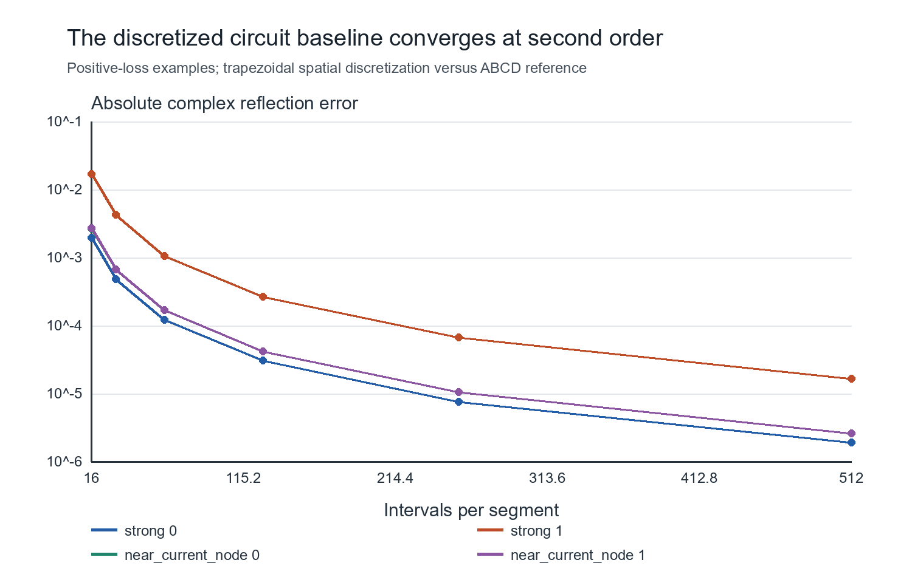

### Independent symbolic verification and reference planes

Wolfram independently checks the same synthetic line model. The ABCD reflection minus its factorized expression simplifies to zero. Both PDEs, the driven interface, the common short and both reflection extractions have zero symbolic residuals. The cascade determinant is one. At a lossless quarter-wave right segment, switch current is zero and local reflection is one for either finite impedance. Numerical weak/strong examples and a strong OFF-state power balance agree with the retained conventional calculation. These checks do not validate a real device's hardware or neural predictions.

The nonsingular reflection formula is

$$
R_s(a,d)=e^{-2\gamma a}r_s(d),\qquad
r_s(d)=\frac{\sinh(\gamma d)+(z_s-1)\cosh(\gamma d)}{\sinh(\gamma d)+(z_s+1)\cosh(\gamma d)}.
$$

Here $r_s$ is reflection at the switch's left face and $R_s$ is reflection at the original port. The local right coordinate $\xi=(x-a)/d$ is zero at the switch's right face, while both faces have global position $x=a$. Learned fields use switch-plane unit-incident normalization:

$$
V_{\mathrm R}(a+d\xi)=e^{-\gamma a}\widetilde V_s(\xi),\qquad
I_{\mathrm R}(a+d\xi)=e^{-\gamma a}\widetilde I_s(\xi).
$$

The tilde fields are not the physical port-driven fields. The default $\alpha=0.03$ model is lossy. At the separately stated $\alpha=0$ quarter-wave limit, use the sinh/cosh expression because tanh has a pole and requires a limit. The verified TeX and original evaluator inputs/results are preserved in `sources/wolfram-verification/` with the retained independent evaluator evidence.

### Literature grounding and the model boundary

[Costa and Borgese (2021)](https://doi.org/10.1109/OJCOMS.2021.3092217) connect a grounded substrate transmission line with parallel patch and varactor impedances. This supports reduced reflection-circuit reasoning, but that topology differs from this study's arbitrary finite series switch.

[Wu et al. (2024)](https://doi.org/10.1049/mia2.12505) connect geometry and embedded RLC choices to phase-sensitive and less-sensitive regions. That supports investigating tunability; it does not diagnose a real device's failed geometries or identify them with this line's quarter-wave node.

The present model is a single-frequency causal analogue. Its line current is not an extracted copper surface-current distribution. The map from actual copper geometry, substrate, switch parasitics and periodic electromagnetic fields to the chosen line lengths and impedances is uncalibrated. No paper cited here makes this series topology a validated model of a real device's device. A literature-backed metasurface equivalent circuit would require its own topology and parameter mapping; we have not silently substituted one into the completed experiments.

[Krishnapriyan et al. (2021)](https://arxiv.org/abs/2109.01050) motivate separating training failure from representational capacity. Our exact-label comparison is an empirical diagnostic of the same architecture, not a proof of uniform representability.

[Rathore et al. (2024)](https://arxiv.org/abs/2402.01868) motivate scrutinizing optimizer behavior in PINNs. They do not establish our cause or promise that L-BFGS fixes it. Our matched gradient-call, runtime and terminal-iterate comparison retains its failed numerical gate and one-seed scope.

[Grossmann et al. (2024)](https://doi.org/10.1093/imamat/hxae011) distinguish solution cost from evaluating a learned solution. This motivates our separate training, reference and inference accounting. Our microsecond circuit baseline is not an expensive FEM or HFSS benchmark.

Three claims remain separate: the reduced equations are numerically and symbolically consistent; the analogue demonstrates weak and strong finite-switch influence; hardware transfer is unvalidated. The first two are supported here. The third needs real geometry, material and switch data with an independent electromagnetic comparison.

Primary sources consulted: Costa and Borgese, *Electromagnetic Model of Reflective Intelligent Surfaces*, IEEE OJCOMS 2, 1577-1589; Wu et al., *Embedded circuit analysis and design method for reconfigurable metasurface element*, IET MAP 18(11), 819-829; Krishnapriyan et al., *Characterizing Possible Failure Modes in Physics-Informed Neural Networks*; Rathore et al., *Challenges in Training PINNs: A Loss Landscape Perspective*; Grossmann et al., *Can physics-informed neural networks beat the finite element method?*, IMA J. Applied Mathematics 89(1), 143-174.

### Worked reference and PINN-error arithmetic

These are transparent derivations and arithmetic for a reader to reproduce by hand. They do not claim that a named team member has already performed or signed off a manual check. Numerical scripts cross-check the displayed arithmetic, rather than replacing it.

#### Conventional reference at a lossless quarter-wave right segment

Use the separately declared lossless limit, $\gamma=i2\pi$, $d=0.25$, $a=0.11$, and the same finite switch and short in both states. This is not the default lossy training model.

Then $g=\gamma d=i\pi/2$, so $\sinh g=i$ and $\cosh g=0$. Substitution into the factorized reflection gives

$$
r_s=\frac{i+(z_s-1)0}{i+(z_s+1)0}=1,
\qquad R_s=e^{-2\gamma a}=e^{-i1.3823007676}.
$$

Thus $R_s=0.1873813146-0.9822872507i$, with $|R_s|=1$. Both states agree, because zero current at the switch makes a finite impedance change ineffective in this limit. This is a check of the equations, not an imposed half-turn between states.

#### One saved PINN output-error value

Take primary seed 0, `test_blocked-0000`, OFF, the first blocked OFF row in the retained CSV. Selection is by file order, not largest error. Its default lossy-model geometry is $d=0.2002196706$, $a=0.1258368734$.

The independent reference and saved prediction in `outputs/switched-surrogate/pinn_seed-0_states.csv` are

$$
R=-0.9012054598+0.0922533169i,\qquad
\widehat R=-0.4184987096-0.7931354358i.
$$

Subtract components, then square and add:

$$
\Delta R=0.4827067502-0.8853887527i,
$$

$$
|\Delta R|=\sqrt{0.4827067502^2+0.8853887527^2}
=\sqrt{0.2330058067+0.7839132435}
=1.0084240428.
$$

The CSV records `complex_R_error=1.0084240428252733`. This is absolute complex reflection error at one port/state, not relative field L2. Independent NumPy evaluation of the saved weights and a separate 3-by-3 wave solve check the underlying numbers. A small magnitude error alone would miss the large phase/output error in this example.

## 4. Experiments and bounded diagnosis

### Frozen comparison

The geometry-only protocol was written before fitting and retained unchanged, SHA256 `2a1b3377276750c0ed7afa007eae94bfd0c993289564f65cd7e1e39bfda5127d`. Random seed 49420261020 creates 256 training, 96 validation, 224 off-grid test and 160 blocked test geometries. Both states of each geometry stay together. No two d values differ by less than 2e-5. The interval d in [0.195,0.222] has no training or validation geometry and no residual training. Training and off-grid tests lie outside it. This is a deliberately difficult coverage stress test, not a representative deployment distribution.

One 3-64-64-4 tanh network maps local right coordinate xi, normalized d and state to complex V/I. It has 4,676 parameters. Both state values occur in training; no claim covers unseen impedances. With unit incident amplitude at the switch, the effective driven interface is

    V_right(0)+(1+z_s) I_right(0)=2.

On xi in [0,1], the PDE residuals are V_xi+gamma*d*I and I_xi+gamma*d*V. The common short gives V_right(1)=0. These are the original finite-switch conditions after analytic left propagation, not an ideal state-dependent boundary. The PINN objective sums mean squared complex PDE residuals, driven-interface residual divided by four, and terminal voltage residual. No initial-condition loss applies to a harmonic problem.

The supervised control has identical architecture, initial weights, geometry/xi sample stream, seeds, optimizer schedule and update count. It minimizes mean |V-Vref|^2+|I-Iref|^2. Reference fields appear only as diagnostics in PINN runs. Both modes compute the same diagnostic terms at every update; this overhead is included in measured training cost. Each update draws 32 training geometries, four xi values per geometry, and both states. Each of three seeds runs 4,000 Adam updates with cosine learning rate 0.002 to 0.0002, float64, one CPU thread. No early stopping, model selection, remedy or post-test hyperparameter tuning occurred. Validation remains a separate diagnostic set.

Cheap interpolation uses the same 256 training geometries, interpolates real/imaginary local r_s versus d, and applies the analytic upstream factor. Endpoint extrapolation is constant. It has no field model and no PDE residual metric. The exact factorized calculation is a further conventional baseline; it agrees with ABCD to numerical precision.

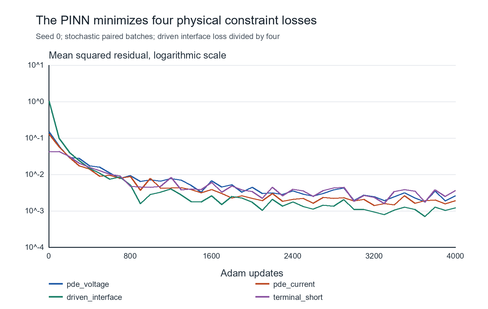

### Screening decisions and field errors

The 180-degree target and the tolerance choices here are synthetic screening criteria, not verified laboratory acceptance requirements. The primary illustrative rule is phase separation within 15 degrees of 180 and minimum magnitude at least 0.8. Sensitivity analysis retains all nine combinations of phase tolerance 5/15/30 degrees and magnitude floor 0.5/0.8/0.95 in `decision-metrics.csv`. These are not lab acceptance requirements.

Phase is undefined for analysis if either magnitude is below 0.05. A masked prediction counts as infeasible, and coverage is reported. Reflection and magnitudes are never clipped. Sensitivity means feasible designs retained; specificity means infeasible designs rejected. A false feasible decision promotes an inadequate design; a false infeasible decision discards an adequate one.

The off-grid test contains 21 feasible and 203 infeasible designs. The blocked test contains 10 feasible and 150 infeasible designs. Validation has 7 and 89. Primary decisions are:

| Method | Seed | Test | TP / feasible | False infeasible | False feasible | Sensitivity | Specificity |
|---|---:|---|---:|---:|---:|---:|---:|
| pinn | 0 | offgrid | 21/21 | 0 | 0 | 100.0% | 100.00% |
| pinn | 0 | blocked | 0/10 | 10 | 0 | 0.0% | 100.00% |
| pinn | 1 | offgrid | 21/21 | 0 | 2 | 100.0% | 99.01% |
| pinn | 1 | blocked | 0/10 | 10 | 0 | 0.0% | 100.00% |
| pinn | 2 | offgrid | 21/21 | 0 | 1 | 100.0% | 99.51% |
| pinn | 2 | blocked | 0/10 | 10 | 0 | 0.0% | 100.00% |
| supervised | 0 | offgrid | 21/21 | 0 | 1 | 100.0% | 99.51% |
| supervised | 0 | blocked | 0/10 | 10 | 0 | 0.0% | 100.00% |
| supervised | 1 | offgrid | 21/21 | 0 | 0 | 100.0% | 100.00% |
| supervised | 1 | blocked | 0/10 | 10 | 0 | 0.0% | 100.00% |
| supervised | 2 | offgrid | 21/21 | 0 | 0 | 100.0% | 100.00% |
| supervised | 2 | blocked | 0/10 | 10 | 0 | 0.0% | 100.00% |
| interpolation | n/a | offgrid | 21/21 | 0 | 0 | 100.0% | 100.00% |
| interpolation | n/a | blocked | 0/10 | 10 | 0 | 0.0% | 100.00% |

The 93.75% overall accuracy of an always-infeasible classifier on the blocked test would conceal zero feasible-design sensitivity. No overall accuracy is used as the headline result. Near-boundary reporting selects exact phase error within five degrees of the tolerance, or exact minimum magnitude within 0.05 of its floor. The primary near-boundary subsets have 10 off-grid designs, 4 feasible, and 85 blocked designs, 10 feasible. PINN off-grid specificity there ranges from 66.7% to 100%; blocked sensitivity remains zero. These small class counts limit statistical confidence.

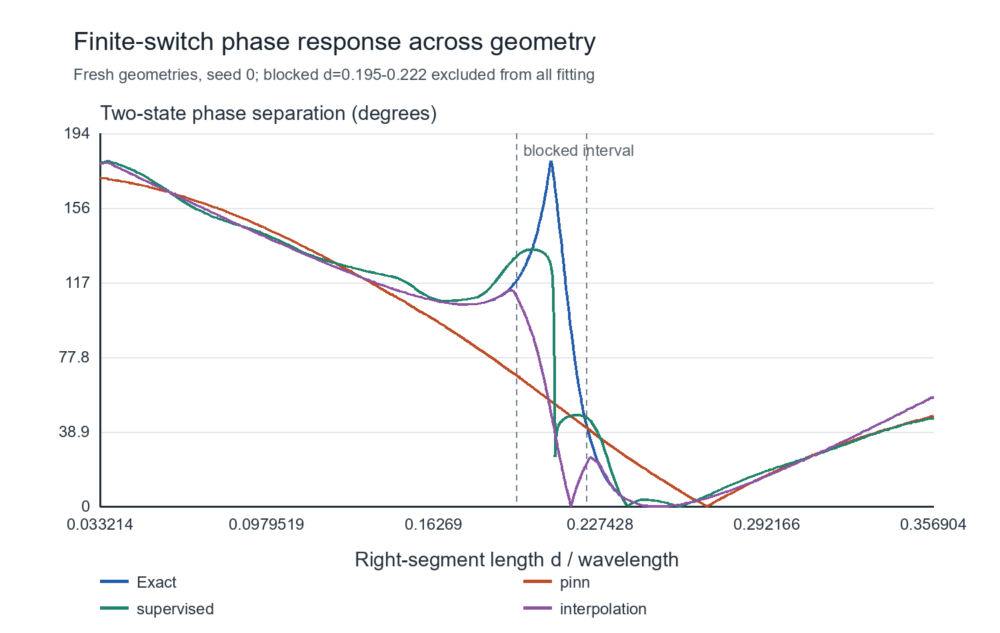

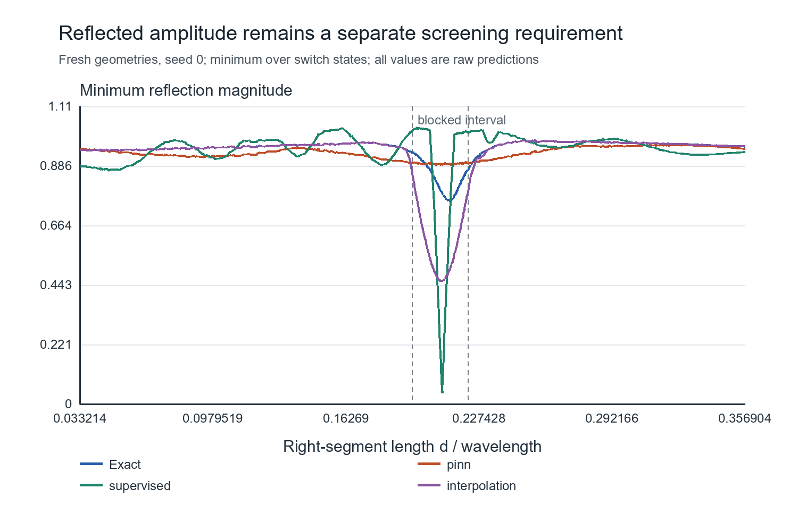

The table gives ranges across the three fixed seeds, with a single value for interpolation. Each seed's error statistic is computed first. Complex R error uses the worse state per geometry. Field errors integrate the complex field over both physical segments; upstream fields use the predicted R and exact propagation. Phase errors include only valid phase predictions.

| Method | Test | Median complex R error | Median phase error, deg | 95th-percentile phase error, deg | Median voltage L2 error, % |
|---|---|---:|---:|---:|---:|
| pinn | offgrid | 0.0607-0.0681 | 3.35-4.01 | 20.7-23.8 | 3.32-3.4 |
| pinn | blocked | 1.31-1.33 | 71.4-73.8 | 119-122 | 44.7-45.7 |
| supervised | offgrid | 0.0451-0.0611 | 1.51-2.31 | 9.11-10.7 | 2.3-2.85 |
| supervised | blocked | 0.348-0.476 | 15.3-26.5 | 81.8-128 | 14.1-17.3 |
| interpolation | offgrid | 5.15e-05 | 0.000741 | 0.378 | n/a |
| interpolation | blocked | 0.788 | 62.6 | 130 | n/a |

All PINN phase predictions remain above the mask floor. One supervised blocked prediction is masked in seed 0. The supervised network can achieve substantially smaller field/R errors under the same optimizer budget, but still loses all blocked feasible designs. This separates a solely physics-loss-specific explanation from a limitation shared across the chosen learning/interpolation setup. It does not isolate expressivity, optimization or sampling as the sole neural root cause, and does not prove spectral bias.

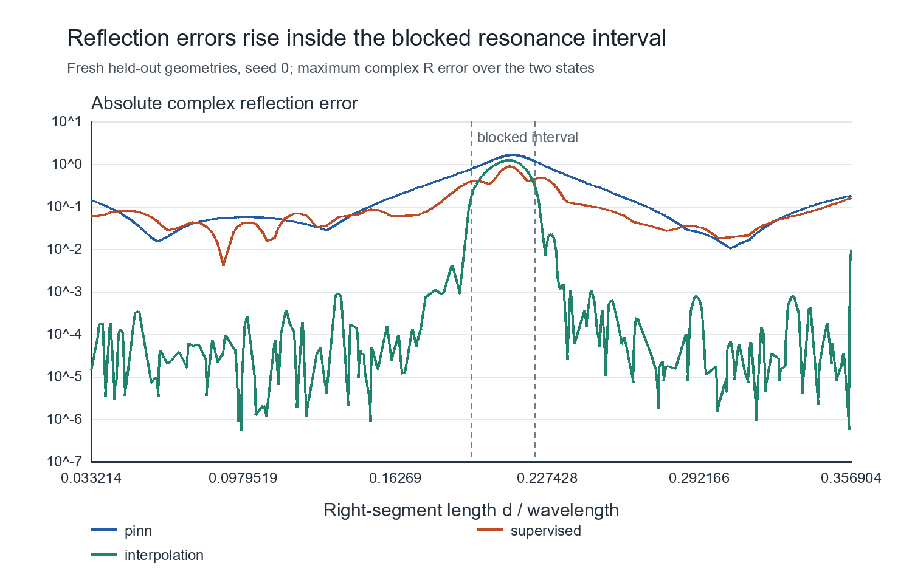

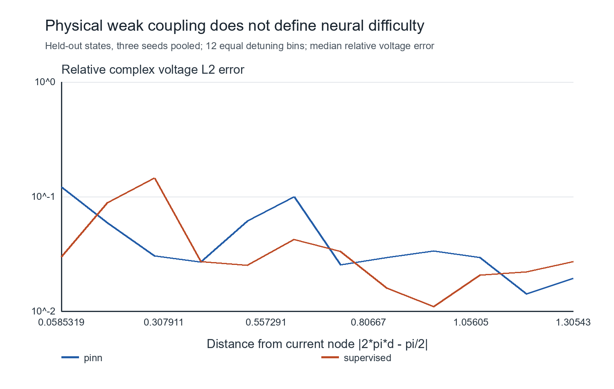

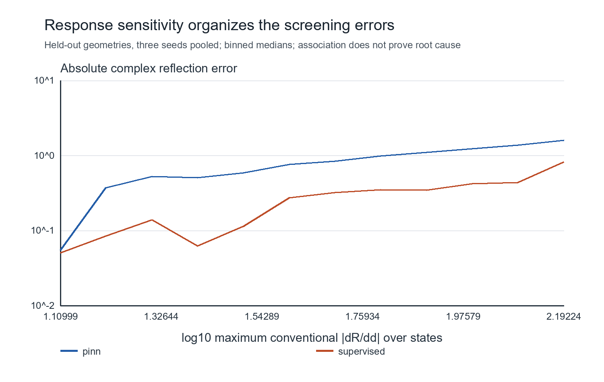

#### Physical and field diagnostics

At the switch-side plane, r_s=1-I_right(0) must agree with r_s=V_right(0)+z_s I_right(0)-1. Port reflection is R_s=exp(-2*gamma*a)r_s; the reported extraction-disagreement metric includes this factor. Maximum disagreement over test states is 0.14-0.215 for PINNs and 2.77-3.53 for supervised networks. Good field fitting alone does not guarantee the interface condition. PINN predicted magnitudes exceed one by more than 1e-8 in 8-21 of 448 off-grid states and 0-95 of 320 blocked states depending on seed. Supervised violations are more frequent. Raw results remain in the packet; no passivity projection hides them.

Maximum absolute PINN power-balance defect on held-out states is 0.0495-0.0606, compared with unit-incident power 0.5. This includes predicted terminal real power, since the learned short can have residual error. Held-out midpoints, not training samples, evaluate PDE residuals; interface and terminal residuals are separate columns. These are numerical warnings about the surrogate, not violations in the passive conventional circuit.

Spatial errors and spectra use seed 0 examples chosen by nearest held-out d to 0.25 and 0.2084. Their selection uses geometry, not worst observed error. DFTs use 128 points without a duplicate endpoint, separately on each segment. Joining across the physical voltage jump would introduce artificial spectral content. The fields are harmonic, so a time axis is inapplicable. Finite-window leakage prevents an exclusive spectral-bias inference.

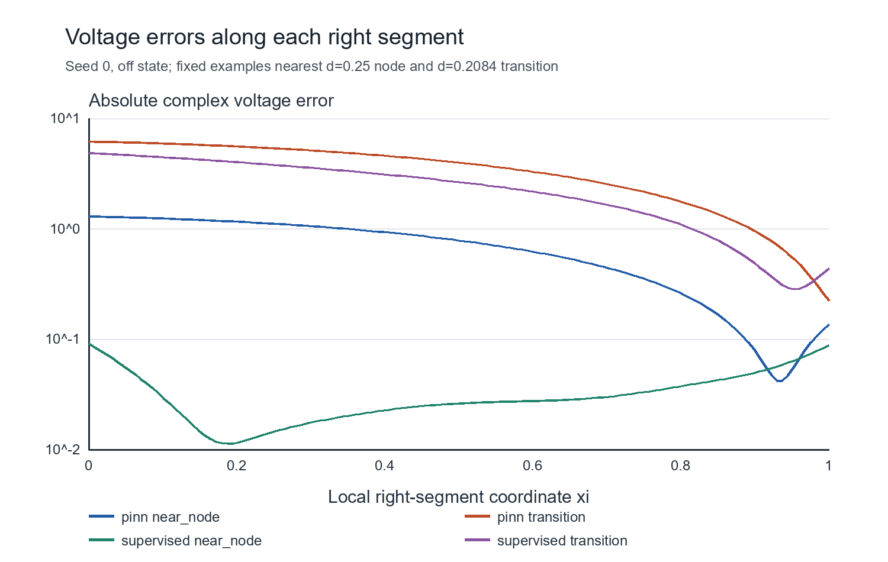

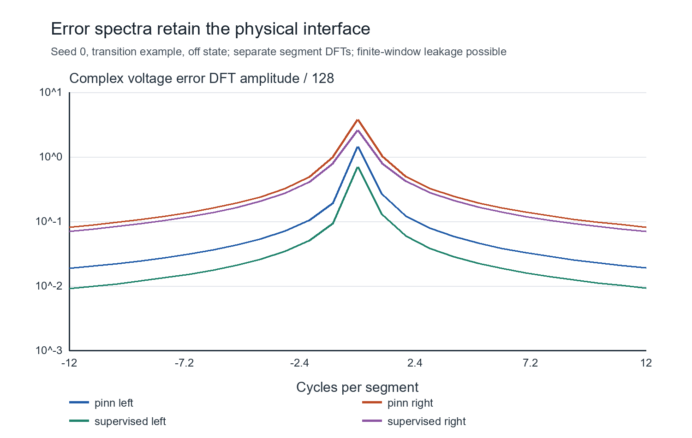

#### Exploratory coverage control

After inspecting the primary tests, a small interpolation-only diagnostic kept 256 geometry nodes and 512 state-response labels, replaced 16 evenly indexed original nodes with 16 equally spaced interior block nodes, and repeated interpolation. Blocked feasible-design detection rose from 0/10 to 8/10, with no false feasible decisions. Off-grid decisions remained 21/21 feasible retained and 203/203 infeasible rejected.

This controlled node-allocation change demonstrates that coverage caused much of this interpolation failure at equal label count. It is post-test exploratory evidence, not an untouched final score or a demonstrated PINN remedy. The six original neural runs, protocol and primary scores remain unchanged.

#### Paired neural coverage test on fresh geometries

To test whether the same allocation change repairs the PINN, one follow-up protocol froze 224 new off-grid and 256 new blocked geometries before fitting. Their d values differ by at least 2e-5 from every prior design and the reallocated training geometries. Both states remain together. The fresh set contains 14 off-grid feasible designs and 210 infeasible, and 18 blocked feasible designs and 238 infeasible. This follow-up was motivated by the primary results, so its scope is a planned replication/intervention rather than a new unbiased estimate of lab deployment performance.

The intervention changes exactly 16 of the 256 training geometries to equally spaced interior block locations. Architecture, seeds, initial weights, sampler, PDE objective, learning-rate schedule and 4,000-update budget remain fixed. There are no field labels in either PINN objective. Original saved models are reused as the paired baseline, and three new PINNs use the reallocated geometry set. The control was frozen at SHA256 `82f7136e80155a27890c84aaf5e202befa08d2948be0b8068b43acebb836b61c`. No further tuning follows from its scores.

| Fresh test | Original PINN, seeds 0/1/2 | Reallocated PINN, seeds 0/1/2 |
|---|---|---|
| Blocked feasible designs retained | 0/18, 0/18, 0/18 | 0/18, 0/18, 0/18 |
| Blocked false feasible decisions | 0/238 in every seed | 0/238 in every seed |
| Off-grid feasible designs retained | 13/14, 14/14, 14/14 | 12/14, 14/14, 14/14 |
| Off-grid false feasible decisions | 0, 3, 1 | 0, 3, 0 |

Blocked median complex-R error changes only from 1.333-1.359 to 1.326-1.345; median voltage L2 error changes from 44.4-45.5% to 44.2-45.1%. Covering the gap with this small reallocation is insufficient to recover the resonant response at this PINN budget. This directly rejects that proposed sufficient remedy. It does not establish a unique remaining cause, such as loss imbalance or spectral bias. The narrow controls distinguish method-specific training from shared generalization, and interpolation coverage from PINN response to the same intervention. A complete unique PINN root-cause decomposition remains unestablished. No Path C neural-fix claim is made.

The follow-up weights, frozen protocol, losses, paired fresh decisions and errors are under `outputs/neural-coverage-control/`. Independent forward/wave checks cover another 5,760 response metrics and 6,192 field-reference rows. A disk-space interruption affected CSV writing only; saved checkpoints were reused and reevaluated without duplicate training.

### Direct supervised representability diagnostic

A final bounded control asks whether the same architecture can represent substantially better fields on the covered geometry family. It holds the 3-64-64-4 network, physical model, normalization, 256 covered training geometries and both states fixed. Exact V/I labels use a frozen 17-point spatial grid, 8,704 label vectors. A new 160-geometry covered validation set and 512-geometry holdout were frozen before fitting and separated from prior and training d values by at least 2e-5. Existing test sets remain diagnostic, not pristine. Covered interpolation first passed its validation gate: blocked 95th-percentile complex-R error 0.01055 and all 148 clear-margin decisions correct.

The single seed-0 pilot starts from the existing supervised weights and adds at most 1,200 full-batch L-BFGS gradient evaluations. Checkpoints are selected only by covered-validation complex-R RMS. The predeclared combined criterion requires blocked validation R95 at most 0.03, median field relative L2 at most 5%, and clear-margin sensitivity/specificity at least 90%. A case is marked ambiguous when its exact phase separation is within 2 degrees of 165 or its exact minimum magnitude is within 0.01 of 0.8. These are illustrative diagnostic margins, not lab requirements.

The selected checkpoint is evaluation 1,195 of the 1,200-evaluation budget. Additional runtime is 18.54 seconds, beyond the 10.29-second initializer. Validation median blocked joint V/I relative error is 0.350%, and all 148 clear-margin validation decisions are correct. However, blocked validation R95 is 0.03494, exceeding the frozen 0.03 criterion. The pilot does not pass the combined criterion, so the predeclared rule stops without repeat seeds or tuning.

On the fresh 256-geometry blocked holdout, the same covered PINN seed has median voltage error 44.59% and R95 1.632. Supervised continuation reduces these to 0.393% and 0.03733. The architecture therefore empirically represents substantially more accurate fields than the original physics-training pathway finds. This supports a training-pathway contribution rather than an absolute representational ceiling at the original error level. It does not prove uniform representability, a unique loss/optimizer cause, or an equal-cost improvement. The continuation uses additional computation and full exact field labels.

| Fresh blocked diagnostic cohort | Covered PINN seed 0 | Supervised continuation seed 0 |
|---|---:|---:|
| All feasible designs retained | 0/17 | 12/17 |
| False feasible decisions among 239 infeasible | 0 | 8 |
| Clear-margin feasible designs retained | 0/6 | 6/6 |
| Clear-margin infeasible designs rejected | 213/213 | 211/213 |
| Ambiguous designs reported separately | 37 | 37 |

The off-grid holdout contains 256 designs, 18 feasible: continuation retains 17/18, with no false feasible decisions. Its three ambiguous cases contain the one missed feasible design. All 253 clear off-grid decisions are correct. The blocked full-cohort errors remain visible; clear-margin results do not replace them. The original primary scores and neural coverage-control scores are unchanged.

The frozen protocol, interpolation adequacy, continuation history, selected weights, full and margin-separated decisions and covered-PINN comparison are in `outputs/representability-control/`. Another 2,688 response metrics and 2,064 field-reference rows pass the independent NumPy/wave checks. This is one-seed direct-fit evidence, not a demonstrated PINN remedy or a guaranteed full-credit diagnosis. It strengthens the qualified Path B comparison while retaining the strict failed gate and unresolved finer mechanism.

### Exploratory physics-only optimizer control

The supervised continuation weakened an architecture-only explanation, but added both labels and optimizer work. This follow-up changes optimizer family while holding the physics objective and full-batch continuation fixed. It is exploratory because prior tests were already inspected. It does not isolate the shared full-batch change from earlier minibatch training.

The protocol was frozen before reference class inspection, model evaluation or fitting. It starts both arms from identical covered PINN seed-0 weights with fresh optimizer state. Both use the same 256 reallocated training geometries, paired states, deterministic 17-point spatial grid, unchanged architecture, normalization and PDE(V) + PDE(I) + port/4 + short objective. No reference generator or labels are accessed inside either training closure. Four safeguard tests cover that separation, matched call caps, geometry separation and last-accepted restoration.

The original proposed 80 blocked validation plus 256 blocked holdout geometries could not meet the 0.00002 separation rule after all previous studies. A pre-fit interval audit gives an upper bound of 257 additional separated blocked values. The approved geometry-only amendment uses 64 blocked validation and 128 blocked holdout, plus the original 80 off-block validation and 256 off-block holdout. A 257-candidate admissible pool was constructed, shuffled with seed 49420261023, and allocated without class-based resampling. All new-to-prior and new-to-new d separations exceed 0.00002. The audit, amendment and hashes are retained rather than overwritten.

L-BFGS retains strong Wolfe line search, learning rate 1, history 50, inner max_iter 20 / max_eval 30 and tolerances 1e-9 / 1e-12. Adam uses fixed learning rate 0.0002. Each arm used exactly 1,200 full objective-plus-gradient evaluations, including line-search trials. These are equal calls, not equal wall time or accepted updates. L-BFGS made 1,095 accepted updates in 72.57 seconds and Adam made 1,200 in 70.60 seconds. The cap interrupted a final L-BFGS line search; the last accepted iterate was restored. Endpoints are terminal accepted weights, with no validation checkpoint selection. No arm converged early.

The unchanged combined numerical validation gate requires blocked R95 <= 0.03, median normalized joint right-field L2 <= 0.05, and clear validation sensitivity/specificity >= 0.90 with both classes present. Clear margins remain 2 degrees from 165 degrees and 0.01 from magnitude 0.8. The decision population matches the retained representability gate, all clear validation geometries; blocked clear decisions are also reported separately. R95 takes, for each geometry, the larger complex-reflection error across the two states, then the 95th percentile across geometries. This is distinct from median field error.

| Terminal seed-0 comparison | L-BFGS | Adam |
|---|---:|---:|
| Full objective + gradient evaluations | 1,200 | 1,200 |
| Blocked validation R95 | 1.07051 | 1.61571 |
| Blocked validation median normalized joint right-field L2 | 47.71% | 86.59% |
| All clear validation feasible retained | 6/12 | 6/12 |
| All clear validation infeasible rejected | 126/126 | 126/126 |
| Blocked clear validation feasible retained | 0/6 | 0/6 |
| Blocked holdout R95 | 1.07288 | 1.61203 |
| Blocked holdout median physical voltage relative L2 | 7.5747% | 43.3932% |
| Blocked holdout feasible retained | 0/8 | 0/8 |
| Blocked holdout infeasible rejected | 120/120 | 120/120 |
| Blocked clear holdout feasible retained | 0/2 | 0/2 |
| Maximum blocked holdout power-balance defect | 0.22737 | 0.06536 |

The physical voltage metric integrates squared complex voltage errors over both line segments, normalizes by the reference energy, and takes the median over 256 state cases. It is not the normalized joint right-field metric used by the existing validation gate. Nineteen blocked holdout designs are ambiguous; the full counts above retain them. The off-grid holdout has 36 feasible and 220 infeasible designs; both arms classify all of them correctly, including all 253 clear designs.

L-BFGS substantially reduces field and reflection error relative to Adam under this matched-call continuation. That establishes an optimizer-family effect conditional on this one seed and fixed full-batch pathway. It does not establish useful screening: both miss every feasible blocked holdout design, and both fail the unchanged validation gate. The predeclared rule therefore stops after seed 0, without repeats or tuning. Power consistency is not uniformly improved; L-BFGS has the larger blocked power defect, against incident power 0.5. Raw residuals, boundary defects, extraction disagreement, passivity checks and power defects are retained by region, including dense residuals at 128 held-out midpoints.

Independent NumPy forward evaluation and a separate wave solve verify another 2,112 reflection metrics and 2,064 selected field-reference rows. This follow-up narrows the diagnosis toward a training-pathway contribution without isolating a unique complete PINN cause. It is neither a successful Path C fix nor hardware validation.

Protocol SHA-256: `a8bac535c4c58bdb837dfeda38890ebd86e5413838e895096d136208032a56f9`. See `outputs/optimizer-continuation-control/` for the prospective request, infeasibility audit, amended frozen geometry-only protocol, start hashes, accepted-step logs, terminal weights, region summaries and independent verification. Completed outputs refuse automatic reruns.

<!-- final residual and boundary diagnostic -->

### Controlled sampling-gap and objective diagnosis

This historically informed follow-up explicitly supplies an increasing sampling-difficulty axis. The width w of a centered missing-training interval around d=0.2085 increases from 0 through 0.0135 to 0.027. Its training sets are nested: 256, 248 and 240 geometries. Larger w removes support near the same difficult finite-switch field family. This is a sampling-sparsity knob, not a claim that electrical length or the retrospective gain G is globally monotone. It is nested support removal, not relocation at fixed sample count. Minimum train/evaluation d separation for the smaller gaps is about 6.76e-6, not the primary 2e-5 threshold; no exact overlap occurs.

Every physics/reference pair starts from the identical failed primary PINN seed-0 checkpoint. Architecture, normalization, paired states, 17 spatial training nodes, full-batch L-BFGS, fresh optimizer state and 1,200 gradient calls are matched. Only the objective differs within a pair. Reference labels are available only to direct-reference training. The same 160 blocked and 224 off-grid primary geometries are evaluated at 128 spatial midpoints. Those cohorts were inspected previously, so these are diagnostic comparisons, not pristine tests. Wider gaps have fewer training constraints, which is the intended sampling intervention; equal gradient calls are not equal point work or runtime.

The protocol and diagnostic criteria were frozen before these six fits, after the previous studies were known. All six terminal accepted checkpoints are reported. There is no new seed/architecture search or result-driven extension. The separate deployment gate retains R95<=0.03, median joint-field L2<=0.05 and sensitivity/specificity>=0.9 with both classes present. The diagnostic field contrast is not a replacement acceptance tolerance.

| Gap width w | Objective | Training geometries | Gradient calls | Blocked joint right-field L2, median | Blocked max-state R95 | Feasible retained | False feasible | Deployment gate |
|---|---|---:|---:|---:|---:|---:|---:|---|
| 0 | physics | 256 | 1200 | 9.7902% | 1.071359 | 0/10 | 0/150 | failed |
| 0 | supervised | 256 | 1200 | 0.3543% | 0.041350 | 10/10 | 10/150 | failed |
| 0.0135 | physics | 248 | 1200 | 14.2814% | 1.214719 | 0/10 | 0/150 | failed |
| 0.0135 | supervised | 248 | 1200 | 0.5787% | 0.151102 | 8/10 | 16/150 | failed |
| 0.027 | physics | 240 | 1200 | 20.2759% | 1.359236 | 0/10 | 0/150 | failed |
| 0.027 | supervised | 240 | 1200 | 1.6389% | 0.898411 | 0/10 | 0/150 | failed |

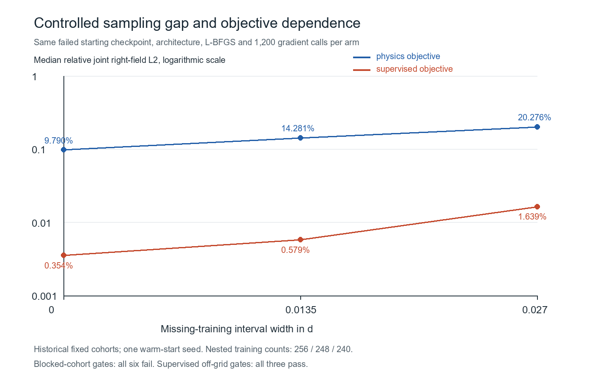

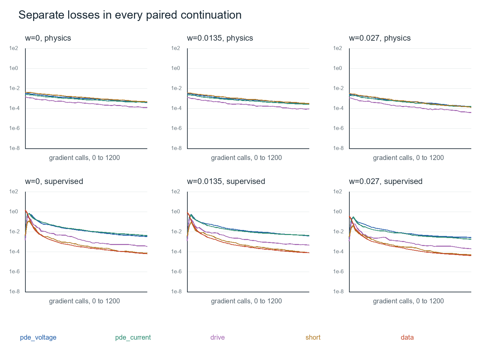

New continuation fit times, CPU float64 with one thread, are measured separately from label setup and evaluation:

| Gap width | Physics fit seconds | Reference fit seconds |
|---|---:|---:|
| 0 | 65.276 | 40.486 |
| 0.0135 | 61.911 | 38.486 |
| 0.027 | 58.998 | 38.047 |

Reference generation and evaluation are separately recorded in each result JSON. Physics training uses no reference labels. These are fixed-call diagnostics, not a new inference-speed benchmark. The original P5 single/batch timings and negative break-even result remain in force.

The displayed relative L2 jointly normalizes V and I on the right segment, then takes the median over 320 blocked state cases. It is not the physical two-segment voltage metric from the earlier optimizer study. Both objective arms worsen monotonically over these three predeclared widths. At full coverage, changing the objective reduces median field error by 27.63 times, with the same model, start, optimizer and input locations. The largest gap raises direct-reference field error by 4.63 times. All pairs reach the same gradient-call cap. These outcomes meet the frozen diagnostic contrast criteria and separate objective dependence and missing-support effects from a pure architecture-capacity ceiling at the observed field-error scale.

All six blocked-cohort deployment gates still fail. All three supervised off-grid arms pass their off-grid gate; these do not replace the blocked result. The fully covered reference-trained arm retains 10/10 feasible cases but also promotes 10/150 infeasible cases and has R95=0.04135, above 0.03. No acceptance threshold is relaxed to call that a success. At the largest gap it retains 0/10 feasible cases. A single seed and historical cohorts limit generalization. This does not uniquely identify spectral bias, a Hessian mechanism, boundary imbalance or the entire original screening failure.

The earlier matched optimizer experiment independently identifies an optimizer-pathway effect: identical starting weights, physics objective, inputs and 1,200 gradient calls give blocked physical-voltage median L2 43.3932% with Adam and 7.5747% with L-BFGS. L-BFGS improves 204/256 blocked state cases, but both arms retain 0/8 feasible designs and fail their validation gate. That is a bounded Path B diagnosis of attained optimization error, not a successful remedy. Together these controlled findings identify optimizer, objective and coverage contributions under stated conditions, while the unique finer mechanism remains open.

See [frozen gap protocol](outputs/gap-objective-diagnosis/frozen-protocol.json), [all six results](outputs/gap-objective-diagnosis/results.json), saved states/losses/weights beneath that folder, and [worked verification](worked-verification.md). Independent NumPy forward algebra and wave-system references check every saved output/error value, including a separate midpoint field calculation for each new model. Existing negative studies remain unchanged.

### Residual transport and reflection-error identity

This is a problem-specific derivation, not an identity quoted from the literature. It applies to the normalized right fields used by the retained networks. It does not identify line current with copper surface current.

Let $g=\gamma d$, $J=\begin{pmatrix}0&1\\1&0\end{pmatrix}$ and $u=(V,I)^T$. For a predicted field, define $f=u'+gJu$, $b_0=V(0)+(1+z_s)I(0)-2$ and $b_1=V(1)$. If $e=\widehat u-u_\mathrm{exact}$, then $e'=-gJe+f$. Variation of constants gives

$$
e(1)=e^{-gJ}e(0)+\int_0^1e^{-gJ(1-t)}f(t)\,dt.
$$

Writing $c=\cosh g$, $s=\sinh g$ and

$$
q=\int_0^1[\cosh(g(1-t))f_V(t)-\sinh(g(1-t))f_I(t)]\,dt,
$$

the two boundary equations are

$$
\begin{pmatrix}1&1+z_s\\c&-s\end{pmatrix}e(0)
=\begin{pmatrix}b_0\\b_1-q\end{pmatrix}.
$$

For $D=(1+z_s)c+s\ne0$, Cramer's rule yields $e_I(0)=(c b_0+q-b_1)/D$. Therefore the port reflection error is

$$
\Delta R=-e^{-2\gamma a}\frac{c b_0+q-b_1}{D}.
$$

The port, termination and interior contributions are complex signed quantities. Their magnitudes do not add in general, and cancellation can be substantial. Subtracting one contribution is an a posteriori counterfactual of this linear error equation, not a separately trained neural remedy or a free inference operation.

For the continuous counterpart of the retained physics loss, let

$$
\eta^2=\int_0^1(|f_V|^2+|f_I|^2)\,dt+|b_0|^2/4+|b_1|^2.
$$

Cauchy-Schwarz gives the absolute output-error bound

$$
|\Delta R|\le G\eta,\quad
G=\frac{|e^{-2\gamma a}|}{|D|}
\sqrt{4|c|^2+1+\int_0^1(|\cosh(g(1-t))|^2+|\sinh(g(1-t))|^2)\,dt}.
$$

This gain depends on the stated residual/boundary norm and reference plane. It is not a neural Hessian condition number and cannot be inferred from the training loss alone. The implementation must verify signs, reference normalization, chain rule, quadrature convergence and the exact bound on analytic perturbations and frozen network checkpoints before this derivation is used as evidence.

Stability-based error analysis is motivated by [Mishra and Molinaro](https://arxiv.org/abs/2006.16144); operator conditioning is discussed by [Liu et al.](https://arxiv.org/abs/2402.00531). Those sources motivate the diagnostic, not this particular formula or its empirical conclusion.

### Historical signed residual budget

The verified identity was evaluated without fitting on 12 retained models and 10,048 historical state cases. The largest identity discrepancy is 2.87e-14; the largest 64-to-128 quadrature change is 3.15e-14. There are zero bound violations. These cohorts were previously inspected, so this is a historical diagnostic, not a pristine holdout.

The table reports medians over blocked state cases. Signed projections are component projections onto the total error, not magnitude shares. They can be negative or exceed one when components cancel. Post-hoc subtraction includes quadrature and is not a trained remedy.

| Model | Median state reflection error | Boundary signed projection | Interior signed projection | Error after boundary subtraction | Feasible designs retained, original / subtraction |
|---|---:|---:|---:|---:|---:|
| primary-pinn-0 | 0.40344 | 0.521 | 0.479 | 0.15433 | 0/10 / 0/10 |
| primary-pinn-1 | 0.39214 | 0.491 | 0.509 | 0.19439 | 0/10 / 0/10 |
| primary-pinn-2 | 0.39591 | 0.614 | 0.386 | 0.17279 | 0/10 / 0/10 |
| primary-supervised-0 | 0.25236 | -1.274 | 2.274 | 1.3968 | 0/10 / 0/10 |
| primary-supervised-1 | 0.2292 | 1.107 | -0.107 | 0.89815 | 0/10 / 0/10 |
| primary-supervised-2 | 0.28029 | -0.457 | 1.457 | 1.1162 | 0/10 / 0/10 |
| covered-pinn-0 | 0.39294 | 0.506 | 0.494 | 0.16348 | 0/18 / 0/18 |
| covered-pinn-1 | 0.38669 | 0.521 | 0.479 | 0.17682 | 0/18 / 0/18 |
| covered-pinn-2 | 0.38933 | 0.553 | 0.447 | 0.17219 | 0/18 / 0/18 |
| representability-supervised-0 | 0.0083377 | -0.218 | 1.218 | 0.031682 | 12/17 / 0/17 |
| optimizer-lbfgs-0 | 0.064723 | 0.538 | 0.462 | 0.021063 | 0/8 / 0/8 |
| optimizer-adam-0 | 0.38308 | 0.556 | 0.444 | 0.17157 | 0/8 / 0/8 |

Both boundary and interior contributions matter in the failed PINNs. Removing boundary contributions reduces many reflection errors but recovers no missed feasible designs in those blocked cohorts. For the supervised representability fit, cancellation means boundary subtraction worsens the median state reflection error and discards its retained feasible designs. This explains error propagation and cancellation; it does not diagnose the training mechanism.

#### Measured geometry difficulty and spatial diagnostics

The output-residual gain G is a separate, non-monotone stability diagnostic. The controlled nested sampling-gap study is the new P3 knob. This older diagnostic plots the held-out relative voltage L2 against this measured gain. States above the displayed L2 limit are counted explicitly. P4 uses the spatial complex error at a fixed geometry and state, with separate segment transforms in the retained full figures. This differs from a parameter-screening trace.

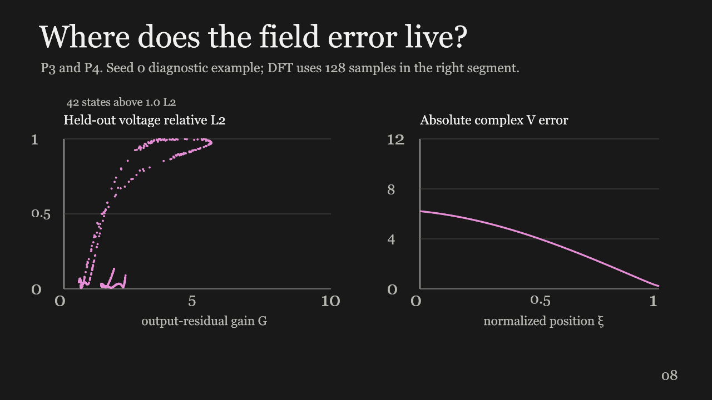

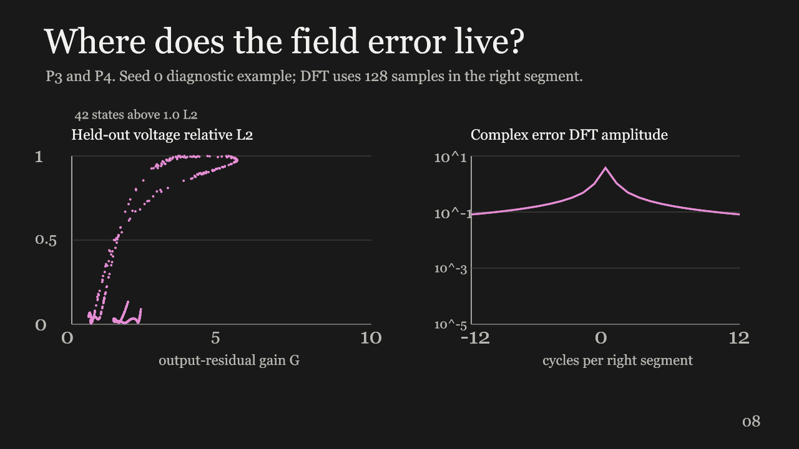

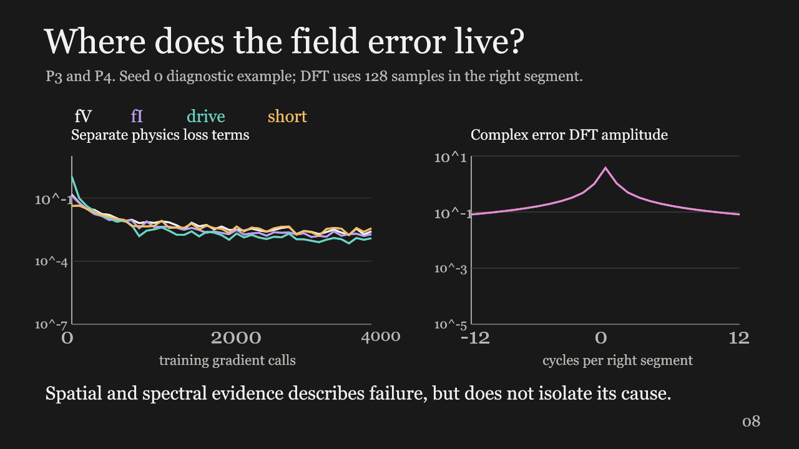

The spectral example is primary seed 0, OFF, d=0.208395. The DFT uses 128 samples without the duplicate endpoint and a 1/128 amplitude normalization. Finite-window leakage remains possible. Loss histories, spectra and gain association do not prove gradient imbalance, spectral bias or a Hessian condition number.

### Exact boundary enforcement is insufficient at this budget

Six fresh, paired fits compared soft penalties with exact endpoint enforcement. All six failed the unchanged validation gate. The hard transform made the driven boundary and short exact but left large interior and reflection error. Exact endpoint enforcement was insufficient to repair this model at the fixed budget. The transform also changes the trial-function representation, so this does not establish the original training-failure cause. It does not identify one remaining optimization cause.

The synthetic finite-switch line is a frequency-domain boundary-value analogue. These results do not reproduce or validate a real device's hardware.

#### Prospective controls

Protocol SHA-256 `f72c20160f80341bb93cc8f849450798c49a39b22ff059e224c6aca37320e877`. Selected checkpoints were sealed before final reference access, seal SHA-256 `2f631b0d39ae183a26c19e9c955c5e29a7624c545f53ac84964f222280bce250`.
Same raw 3–64–64–4 tanh network, 4,676 parameters, seeds 0/1/2, identical paired initial weights and minibatch streams, covered 256 training geometries, 4,000 Adam gradient calls and cosine schedule per fit. No reference field or reflection label enters the training objective. Validation chooses among checkpoints every 500 steps, while every fit spends all 4,000 calls. Equal calls do not imply equal runtime.

The transform is $I=i$, $V=v-\xi v(1)-(1-\xi)[v(0)+(1+z_s)i(0)-2]$. Endpoint evaluations remain differentiable. This changes the trial-function representation as well as boundary enforcement. It does not isolate gradient imbalance.

The original 32+32 fresh blocked proposal could not freeze because only 61 separated candidates remained. It became 30 validation plus 30 final before fitting or reference-class inspection. Minimum separation stayed $2\times10^{-5}$. Off-block counts are 80 validation and 256 final.

#### Final results

| Arm | Seed | Selected step | Fit seconds | Blocked max-state reflection error, 95th percentile | Blocked voltage relative L2, median | Max driven-boundary residual |
|---|---:|---:|---:|---:|---:|---:|
| soft | 0 | 4000 | 13.407 | 1.626839 | 44.17% | 0.203 |
| hard | 0 | 4000 | 14.250 | 1.642331 | 44.22% | 2.48e-16 |
| soft | 1 | 4000 | 13.296 | 1.637912 | 44.98% | 0.168 |
| hard | 1 | 4000 | 14.153 | 1.620761 | 43.58% | 4.58e-16 |
| soft | 2 | 4000 | 13.367 | 1.620636 | 44.10% | 0.188 |
| hard | 2 | 4000 | 14.136 | 1.620363 | 43.45% | 2.22e-16 |

All 30 new blocked final geometries are reference-infeasible at the illustrative phase≥165° and magnitude≥0.8 thresholds. Both arms classify all 30 as infeasible. Sensitivity is undefined, so the 100% specificity cannot demonstrate successful screening. Five cases are near the declared thresholds. No new class-enriched sample was added after seeing this result.

On the historical primary blocked cohort, every new arm/seed still misses all 10 feasible cases, with zero false feasible predictions among 150 infeasible cases. This is a previously inspected diagnostic cohort, not new final evidence.

Hard enforcement reduces terminal voltage to zero and driven-boundary/extraction disagreement to roundoff. It does not fix the final reflection tail or spatial field accuracy. Its maximum blocked power-balance defect is larger than the matched soft arm in every seed, so endpoint correctness does not imply energy consistency.

#### Independent checks and cost

Saved state reflections were recomputed with standalone NumPy network algebra and an independent complex wave-system reference. Spatial derivatives were compared with NumPy finite differences. The exact residual transport identity was checked for every final state with quadrature. See results.json for maxima and counts.

Reflection-only hard inference uses the unchanged current output and one raw network pass. The conventional factorized reference remains faster for both single and batch queries. There is no positive break-even query count. Fit wall time includes validation as a subset. Reference generation occurs outside that fit timer. Total timed setup is fit wall time plus reference generation, without adding validation a second time.

#### Decision

Keep the conventional model for this analogue. Use the verified signed residual budget to guide a separately frozen experiment only for a separately agreed diagnostic. Do not claim Path C success, a unique PINN root cause, a full-wave speedup, or a hardware remedy. The current Path B evidence establishes a failure and shows exact endpoint enforcement was insufficient to repair this model at the fixed budget, while optimization, representation and sampling remain coupled alternatives.

Sources: [exact boundary trial functions](https://arxiv.org/abs/2104.08426), [derived error identity](residual-error-identity.md), [protocol](outputs/hard-boundary-control/frozen-protocol.json), [all six results](outputs/hard-boundary-control/results.json), [historical comparison](outputs/hard-boundary-control/historical-comparison.json).

### Cost and value

Training takes 14.19-14.35 seconds per PINN seed and 10.04-10.29 seconds per supervised seed. About 0.59-0.61 seconds of on-demand reference generation is included in each measured training time. Do not add it twice. These costs include shared diagnostic calculations and use one local CPU thread with PyTorch float64. Full software/platform details are in `frozen-protocol.json`. Reference generation for interpolation is cheap; its retained setup timing also includes evaluation and is explicitly labeled as such.

Nine timing repetitions include construction of query inputs and both switch states. Batched timings use the 384 held-out designs. Each repetition averages 100 single queries or five batches.

| Method | Single two-state query | Batched cost per two-state design |
|---|---:|---:|
| ABCD, scalar Python | 4.15-4.31 microseconds | 4.25-4.32 microseconds |
| Factorized analytic, NumPy | 11-11.2 microseconds | 0.201-0.205 microseconds |
| Complex interpolation, NumPy | 14.9-15.8 microseconds | 0.253-0.27 microseconds |
| Neural, value-only forward and input construction | 126-129 microseconds | 2.47-2.55 microseconds |

The final neural timing uses a value-only forward pass with the same saved weights, not the derivative-producing field diagnostic path. This inference-only correction followed independent review and caused no retraining or accuracy selection. Equality with the original predictions is checked in the test suite and across saved query states.

Use the faster conventional implementation for each query mode in N*=T_train/(T_solver-T_inference). The denominator is negative for every trained model in both modes, so there is no positive break-even. Comparing neural batches only with scalar Python loops would create a misleading benefit. Timing measures these implementations and excludes engineering/development labor. It cannot be extrapolated to HFSS or unmeasured storage workflows.

## 5. Recommendation memo

To the research collaborator, identity withheld pending permission
From Team 6, MAE494/598 design optimization
21 October 2026
Draft for team review. Unsent.

Our finite-switch transmission-line analogue tests one proposed current-participation mechanism while keeping the geometry and circuit synthetic. It is not a calibrated model of your unit cell. A finite switch has little influence near a current node and a strong influence elsewhere; independent conventional calculations support this within the analogue.

The primary neural models retain 21/21 feasible off-grid designs but miss all 10 feasible designs in a withheld interval, across three seeds. Our 165-degree phase cutoff and 0.8 magnitude floor are illustrative, not your confirmed tolerances.

Controlled follow-ups identify bounded causes of attained numerical error. With identical starting weights, inputs, physics objective and 1,200 gradient calls, L-BFGS reduces median blocked physical-voltage error from 43.39% to 7.57% relative to Adam, yet both still miss every feasible blocked design. A separate matched-objective study finds that increasing a nested missing-training interval increases field error for both physics and direct-reference training. At full coverage, reference training fits much better fields with the same network and optimizer. These results show optimizer, objective and coverage dependence. They do not uniquely explain the entire original failure.

All six exact-boundary validation gates and all six new gap/objective blocked-cohort gates fail. All three new supervised off-grid arms pass their off-grid gates. Exact endpoints do not ensure accurate interiors or useful decisions. The fresh boundary-control blocked set contains no feasible cases, so sensitivity there is undefined. Negative results and false feasible decisions remain visible.

Keep the conventional solver for this analogue: its measured query cost is lower than neural inference, so there is no positive training break-even. We have not benchmarked your full-wave solver or storage workflow.

For follow-on work, agree on useful tolerances and a permitted small unit-cell family, then reserve independent geometries near response transitions. Compare interpolation and neural methods against conventional responses, reporting both discarded feasible and promoted infeasible cases. Time solver work, storage and orchestration separately. Hardware validation is needed for a hardware claim, not for the course's allowed synthetic study.

## 6. Assumptions and limitations

The synthetic distortionless line, common short, fixed frequency, normalized finite switch impedances and restricted geometry ranges retain one current-coupling mechanism. They omit actual three-dimensional periodic copper, materials, radiation, bias circuitry, measured switch parasitics and manufacturing. Phase separation is effectively one-dimensional in d. The deliberate held-out gap follows conventional exploration and is a coverage stress test, not a deployment distribution. Illustrative thresholds do not establish useful lab accuracy; microsecond circuit timings do not establish HFSS or I/O savings. The analogue node mechanism and bounded numerical causes are established; a unique finer mechanism and hardware transfer remain unestablished.

### References

- [Official Project 3 requirements and rubric](https://designinformaticslab.github.io/DesignOptimization2025/project3.html).
- [Chew, lossy transmission lines](https://wcchew.ece.illinois.edu/chew/ece350/ee350-11.pdf).
- [Costa and Borgese, reflective intelligent surfaces](https://doi.org/10.1109/OJCOMS.2021.3092217).
- [Krishnapriyan et al., PINN failure modes](https://arxiv.org/abs/2109.01050).
- [Rathore et al., loss landscapes](https://arxiv.org/abs/2402.01868).
- [Exact-boundary trial functions](https://arxiv.org/abs/2104.08426).
- [Grossmann et al., cost comparisons](https://doi.org/10.1093/imamat/hxae011).

### Reproducibility and review status

See [README.md](README.md), [worked-verification.md](worked-verification.md) and the unchanged frozen protocols with their ERRATUM.md notes. All core figures are under outputs/figures-switch; no presentation assets are required. No new outreach, memo sending, public publication or coursework submission has occurred. Approval and the pending human evidence remain separate from the completed local technical work.
