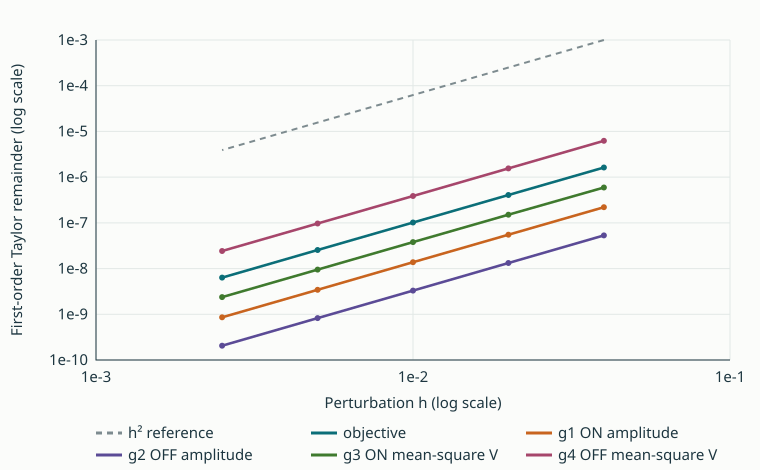
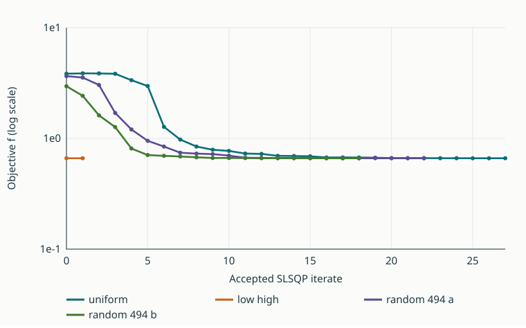

## 1. What this study establishes

The finite-element design reduces the nonlinear-model objective from **3.84135 to 0.661346**, a **82.78%** reduction, while satisfying all four declared response constraints. The final reflected-wave phase separation is **130.53°**. It does **not** reach Project 3's illustrative 165° screening threshold. That threshold is a diagnostic comparison here, not an omitted constraint claimed to have passed.

The best retained linear and nonlinear searches choose the same loading distribution to numerical precision: six low-capacitance cells before the switch and fourteen high-capacitance cells after it. Nonlinearity changes the predicted response rather than the selected design. Multiple starts expose inferior stationary points and failed solves; they are retained below.

This is an agent-produced, reproducible computational portfolio draft. It extends the synthetic transmission-line mechanism in [Project 3](../Project3-Metasurface/report.md). It is not a calibrated metasurface, a full-wave Maxwell optimization, or an experimental result. The student team must independently check the benchmark derivations and confirm that the instructor accepts this particular custom formulation. No coursework has been submitted.


| Design / evaluation model | Objective | Phase separation (°) | ON &#124;R&#124; | OFF &#124;R&#124; | ON mean-square V | OFF mean-square V | Feasible |
|---|---|---|---|---|---|---|---|
| Initial, nonlinear model | 3.84135 | 7.0541 | 0.978354 | 0.985302 | 2.19177 | 1.66143 | FAIL |
| Linear optimum, linear model | 0.463035 | 139.064 | 0.946317 | 0.989274 | 0.915747 | 1.20447 | PASS |
| Nonlinear optimum, nonlinear model | 0.661346 | 130.534 | 0.946908 | 0.989726 | 0.841777 | 1.09592 | PASS |


## 2. Engineering question and design formulation

The original interview concerned controlling reflected electromagnetic waves through metasurface design. Our reduced question is: how should a distributed capacitive loading be allocated along a switched line to make its two reflected phasors oppose one another, while preserving reflection magnitude and limiting voltage exposure? The [approved Project 3 briefing](../Project3-Metasurface/sources/interview/Post_Interview_Briefing.md) supplies the research motivation, not validation of this new constitutive law or these requirements.

There are **20 independent dimensionless design variables**, one capacitance multiplier cⱼ per fixed cell, with **0.5 ≤ cⱼ ≤ 2.5**. Each cell occupies L/20, where L = 0.36 reference wavelengths. The switch is at a = 0.108. The line geometry is fixed; cⱼ changes material/loading, not a calibrated manufactured width. The 3D display extrudes the one-dimensional model and explicitly labels graphical height encodings.

Let Rₛ = Vₛ(0) − 1 for states s = ON, OFF. The scaled optimization problem is

<p class="equation">minimize f(c) = |R<sub>ON</sub> + R<sub>OFF</sub>|² + (0.002/20) Σ<sub>j=1</sub><sup>20</sup>(c<sub>j</sub> − 1)²</p>

subject to four PDE-response inequalities:

- g₁ = |R<sub>ON</sub>|² − 0.64 ≥ 0.
- g₂ = |R<sub>OFF</sub>|² − 0.64 ≥ 0.
- g₃ = 1.6 − E<sub>ON</sub> ≥ 0.
- g₄ = 1.6 − E<sub>OFF</sub> ≥ 0, where Eₛ = (1/L)∫₀ᴸ|Vₛ|² dx.

E is **normalized mean-square voltage**, not physical stored energy. A local voltage exceeding √1.6 does not by itself violate this spatial-average requirement. The 0.8 amplitude floor is retained from Project 3's illustrative screening requirements. The loading bounds and 1.6 voltage-exposure limit define a synthetic design scenario, not a hardware rating or a standard. The voltage limit was fixed after a coarse pilot and before the final multistart runs. It is loose at the best design. The 0.002 baseline-deviation penalty favors less departure from c = 1; it is not a spatial smoothness penalty.

The phasor-sum objective includes both phase opposition and magnitude matching. Reduced reflection can also reduce this objective, so magnitudes and circular phase separation are reported separately. The magnitude constraints prevent accepting a nearly nonreflecting solution merely because its phasor sum is small.

## 3. Analysis model and finite elements

With exp(+iωt) phasors, normalized incident voltage and reference impedance equal to one, define z = α + iβ, yⱼ = α + iβcⱼ, α = 0.03, β = 2π. On each side of the switch,

<p class="equation">−(V′/z)′ + yV + iβχ|V|²V = 0, &nbsp; I = −V′/z.</p>

The port condition is V(0) + I(0) = 2, the common short is V(L) = 0, and the switch imposes I(a⁻) = I(a⁺), V(a⁻) − V(a⁺) = ZₛI(a). The finite switch impedances are Z<sub>ON</sub> = 0.02 + 0.04i and Z<sub>OFF</sub> = 0.02 − 4i. They come from the synthetic Project 3 analogue.

The nonlinear model uses χ = 0.05; the comparison uses χ = 0. A cubic charge law has a fundamental-harmonic contribution proportional to |V|²V, with the 3/4 projection factor absorbed into χ. Voltage-dependent capacitive loading is motivated by [nonlinear transmission-line research](https://www.mdpi.com/2079-9292/10/18/2278) and [NIST's nonlinear dielectric work](https://tsapps.nist.gov/publication/get_pdf.cfm?pub_id=924675). These sources do not supply our chosen constants. This fundamental-only model omits generated higher harmonics and does not establish transient stability or a measured varactor characteristic.

For a test function w that vanishes at the short, integration by parts gives

<p class="equation">∫[V′w′/z + yVw + iβχ|V|²Vw] dx + (V<sub>L</sub>−V<sub>R</sub>)(w<sub>L</sub>−w<sub>R</sub>)/Zₛ + V(0)w(0) = 2w(0).</p>

This is the implemented weak form, not a finite-difference scheme relabeled as FE. Each cell has eight two-node linear elements in the final optimization: **160 elements, 161 complex free unknowns**. The interface has two coincident nodes so the voltage jump is represented without smoothing. Four-point Gauss quadrature integrates the polynomial nonlinear element residual and tangent. The final node is eliminated for the short. The elementary derivative matrix is [[1,−1],[−1,1]]/h and the consistent mass matrix is h[[2,1],[1,2]]/6. The interface adds [[1,−1],[−1,1]]/Zₛ to its two independent nodes.

The state vector stacks real and imaginary voltages. Newton's method uses the analytic real tangent, a residual-decreasing line search, and a 2×10⁻¹¹ infinity-norm residual tolerance. For V = a + ib, the derivatives of |V|²V with respect to a and b are (3a²+b²)+i2ab and 2ab+i(a²+3b²). They are integrated before multiplication by iβχ. Every solve starts from the linear state; the method can fail or select a local branch, so no global uniqueness claim is made.

The passive balance check is

<p class="equation">1−|R|² = α∫(|V|²+|I|²) dx + Re(Zₛ)|I(a)|².</p>

The usual phasor power factor 1/2 cancels on both sides. The cubic shunt is purely reactive in this reduced model. Current within each P1 element is reconstructed as −V′/z; the switch current follows the voltage jump.

## 4. Verification ladder

All 9 retained automated checks pass. Errors with a zero expected value are absolute defects, because a relative error against zero is undefined. Observed convergence orders are compared with the theoretical second-order target, not treated as zero-error tests.


| Check | Exact target | Computed statistic | Statistic type | Acceptance | Result |
|---|---|---|---|---|---|
| Uniform linear ABCD and mesh convergence | 0 | 1.12233e-05 | absolute defect | < 2e-05 | PASS |
| Manufactured cubic nonlinear solution | 0 | 1.24954e-06 | absolute defect | < 0.0001 | PASS |
| Global passive power balance | 0 | 1.69455e-10 | absolute defect | < 1e-09 | PASS |
| Newton residual | 0 | 5.06311e-12 | absolute defect | < 2e-10 | PASS |
| Real Newton Jacobian directional difference | 0 | 7.88511e-10 | relative norm error | < 1e-07 | PASS |
| Global source-phase equivariance | 0 | 6.95985e-14 | absolute defect | < 1e-08 | PASS |
| Quadratic Newton convergence | 2 | 1.94731 | minimum observed order | pre-roundoff residual orders > 1.8 | PASS |
| Linear limit Newton invariant | 0 | 2.84217e-14 | absolute defect | < 1e-10 | PASS |
| All five implicit-adjoint gradients | 0 | 1.74896e-06 | relative norm error | < 2e-05 | PASS |
| Taylor remainder second order | 2 | 1.98205 | minimum observed order | minimum rate > 1.9 | PASS |


The uniform linear comparison uses Project 3's independent ABCD cascade. At 320 elements, the actual complex port reflections are:


| State | FE reflection | Exact ABCD reflection | Relative error |
|---|---|---|---|
| ON | 0.183384370 -0.961277004i | 0.183373316 -0.961278944i | 1.14686e-05 |
| OFF | 0.184432945 -0.962511034i | 0.184422552 -0.962513215i | 1.08352e-05 |


For the nonlinear manufactured benchmark, choose D = 2+i and V*(x) = B(L−x)+D(L−x)³, with an added constant jump Zₛ[B+3D(L−a)²]/z on the left segment. Select

<p class="equation">B = [2 − D(L³ + 3L²/z + 3Zₛ(L−a)²/z)] / [L + (1+Zₛ)/z].</p>

Then the port, short and interface conditions hold analytically. Insert this field into the PDE to define the source f* = −6D(L−x)/z + yV* + iβχ|V*|²V*. The generated source is integrated with independent eight-point quadrature. At 160 elements, the relative field L2 error is **1.52285e-06**. The benchmark is a mathematical verification, not independent experimental validation. Its expected solution was derived by the coding agent; the rubric's student-first derivation requirement remains a human review item.


## 5. Implicit adjoints and gradient checks

Write the assembled real residual as F(u,c) = 0. Differentiation gives J du/dc = −F<sub>c</sub>, with J = ∂F/∂u at the converged nonlinear state. For any scalar metric q,

<p class="equation">Jᵀλ = q<sub>u</sub>, &nbsp; dq/dc = q<sub>c</sub> − λᵀF<sub>c</sub>.</p>

This differentiates the converged state equation, not the finite sequence of Newton iterations. The material derivative in cell j is the real/imaginary packing of iβ∫<sub>cell j</sub>NᵢV dx. Let S = R<sub>ON</sub>+R<sub>OFF</sub>. Each state's objective derivative has port entries (2 Re S, 2 Im S). Each amplitude-constraint derivative has its state's port entries (2 Re Rₛ, 2 Im Rₛ). For mean-square voltage, q<sub>u</sub> = (2/L)[M Re V; M Im V], with a minus sign for g₃ and g₄. The objective's direct derivative is (2×0.002/20)(cⱼ−1). These cover every objective, constraint and the sole design-variable type.

Central differences perturb each of the 20 coordinates by 10⁻⁵. The relative vector errors are:


| Metric | Relative adjoint / central-difference error |
|---|---|
| Objective | 7.84843e-07 |
| ON magnitude² | 1.74896e-06 |
| OFF magnitude² | 1.51736e-06 |
| ON mean-square V | 5.90118e-08 |
| OFF mean-square V | 2.99589e-08 |


A fixed random direction separately tests q(c+hv)−q(c)−h∇q·v. All five metrics approach O(h²), with minimum observed order **1.98205**.



The retained timing uses **80 forward state solves** for central differences versus **2 forward states and 10 adjoint right-hand sides**, batched by state. Finite differences take **0.53582 s**; the complete adjoint evaluation takes **0.0139375 s** on the recorded machine. This is a small-model, single-run implementation measurement, not a universal speedup or a comparison with HFSS. Runtime changes across machines and simultaneous workloads.

### Supplemental multi-design central-difference sweep


| Metric | Directions tested | Second-order windows | Accuracy checks passed |
|---|---|---|---|
| objective | 9 | 9 | 9 |
| amplitude_on | 9 | 9 | 9 |
| amplitude_off | 9 | 9 | 9 |
| energy_on | 9 | 9 | 9 |
| energy_off | 9 | 9 | 9 |

Three seeded interior designs and three directions per design test the objective and four constraints. Every step and error is retained in [the supplemental evidence](review/gradient-sweep-final-2026-11-16.json). Larger steps were added after earlier windows reached the numerical floor; this diagnostic range was adapted, not preregistered. The solver, seeds, designs, directions and thresholds were unchanged. Small-step deterioration is retained, not hidden. This is an agent-run numerical check, not the student-independent derivation or physical validation.


## 6. Optimization, local minima and KKT interpretation

SLSQP uses the scaled objective, analytic implicit gradients, bounds [0.5,2.5], tolerance 10⁻¹¹ and at most 500 iterations. Both physics models use the same five declared starts: uniform, low-before/high-after, high-before/low-after and two seeded random vectors. All retained outcomes are shown; a failed or worse run is not silently discarded.


| Model | Start | Optimizer success | Objective | KKT stationarity ∞-norm | Termination |
|---|---|---|---|---|---|
| linear | uniform | PASS | 3.86276 | 1.38563e-08 | Optimization terminated successfully |
| linear | low_high | PASS | 0.463035 | 1.38778e-17 | Optimization terminated successfully |
| linear | high_low | FAIL | 2.86866 | 7.54952e-15 | Positive directional derivative for linesearch |
| linear | random_494_a | PASS | 0.463035 | 1.38778e-17 | Optimization terminated successfully |
| linear | random_494_b | PASS | 0.463035 | 1.38778e-17 | Optimization terminated successfully |
| nonlinear | uniform | PASS | 0.661346 | 1.38778e-17 | Optimization terminated successfully |
| nonlinear | low_high | PASS | 0.661346 | 2.77556e-17 | Optimization terminated successfully |
| nonlinear | high_low | FAIL | not available | not available | Newton line search failed |
| nonlinear | random_494_a | PASS | 0.661346 | 2.77556e-17 | Optimization terminated successfully |
| nonlinear | random_494_b | PASS | 0.661346 | 2.77556e-17 | Optimization terminated successfully |




The KKT convention is ℒ = f − Σμᵢgᵢ, with gᵢ ≥ 0 and μᵢ ≥ 0. Active multipliers are reconstructed using nonnegative least squares from analytic gradients. The active-set tolerance is 2×10⁻⁵. This reconstruction checks stationarity and complementarity; it is not proof of global optimality. All 20 variable bounds are active at the selected solution, while the four physical-response constraints have slack. The multipliers therefore express the local value of relaxing loading bounds, not prices on the inactive voltage/magnitude limits.


| Model | Primal violation | Stationarity ∞ | Complementarity ∞ | Active multipliers | Min μ | Max μ | KKT gate |
|---|---|---|---|---|---|---|---|
| linear | 0 | 1.38778e-17 | 4.68069e-15 | 20 | 0.00120469 | 0.294597 | PASS |
| nonlinear | 0 | 1.38778e-17 | 2.46978e-14 | 20 | 0.00127507 | 0.30837 | PASS |


The engineering interpretation is specific: in this design box and at the retained local solution, lower loading before the switch and higher loading after it improve the reflected-phasor objective. No topology optimization or fabricated-dimension optimization was performed. Enlarging the design box or using a different physical family could change the result.

## 7. What the nonlinear component changes

The maximum difference between selected linear and nonlinear design coordinates is **9.59677e-13**. Thus the retained comparison does **not** show a nonlinear redesign. At essentially the same material pattern, the linear model predicts **139.064°** separation and the nonlinear model **130.534°**. Both satisfy the declared constraints. The assignment permits a finding of no design change when supported by evidence. The N2 component is the nonlinear state equation and its Newton/implicit-adjoint treatment, not merely a nonlinear objective.

Reevaluating the selected designs on finer meshes keeps every constraint feasible:


| χ | Elements | Objective | Phase separation (°) | Smallest constraint slack |
|---|---|---|---|---|
| 0 | 80 | 0.463386 | 139.048 | 0.255516 |
| 0 | 160 | 0.463035 | 139.064 | 0.255515 |
| 0 | 320 | 0.462947 | 139.068 | 0.255515 |
| 0 | 640 | 0.462925 | 139.069 | 0.255515 |
| 0.05 | 80 | 0.661706 | 130.52 | 0.256636 |
| 0.05 | 160 | 0.661346 | 130.534 | 0.256636 |
| 0.05 | 320 | 0.661256 | 130.538 | 0.256635 |
| 0.05 | 640 | 0.661233 | 130.539 | 0.256635 |


This evaluates the retained design on finer meshes rather than claiming a separately reoptimized fine-mesh optimum. Cross-evaluations of each design under both physics models are retained in results.json.

## 8. Two PINNs: a separate controlled investigation

Project 3 already handles the physical switch analytically and uses a normalized right-segment field. Splitting at that interface again would not automatically fix the observed design-parameter response difficulty. The supporting study instead tests a specialist for the previously identified difficult right-length interval and another for its complement, compared with a monolithic network under stated capacity and training budgets.

The experiment, its frozen protocol, positive and negative outcomes, design-gradient checks and solver comparisons are in [two-pinn-findings.md](two-pinn-findings.md) and [two-pinn-results.json](assets/two-pinn-results.json). The original Project 3 parameters form a restricted supporting problem. These networks are **not** substituted into the 20-variable FE optimizer above, and no full-design surrogate performance is claimed. The restricted bonus comparison below is evaluated separately.

The first experiment's hard routing introduced artificial discontinuities. A second frozen experiment trained the physical residual of a differentiably blended field, using a logistic overlap width of 0.002 and new held-out designs. This removes hard routing's jump but does not make its design derivatives accurate. Each experiment compares three seeds and matched parameter counts/update/point budgets; FLOPs and runtime are not exactly equal. The new sampling sets are close-neighbor interpolation tests, not previously untouched physics or blocked extrapolation.

### Experiment A: hard parameter routing

| Model | Seed | Reflection error p95 | Median field L2 error (%) | Feasible retained | False feasible | Gradient error (%) | Gate |
|---|---|---|---|---|---|---|---|
| monolithic | 0 | 1.49082 | 5.48472 | 0/24 | 0 | 95.5437 | FAIL |
| two_specialists | 0 | 1.09076 | 4.17138 | 2/24 | 0 | 85.628 | FAIL |
| monolithic | 1 | 1.47565 | 4.60527 | 7/24 | 0 | 95.6212 | FAIL |
| two_specialists | 1 | 1.14034 | 3.86779 | 10/24 | 0 | 89.0482 | FAIL |
| monolithic | 2 | 1.41124 | 4.53248 | 0/24 | 0 | 95.1478 | FAIL |
| two_specialists | 2 | 1.17304 | 4.45794 | 0/24 | 0 | 90.7479 | FAIL |


### Experiment B: differentiable overlap

| Model | Seed | Reflection error p95 | Median field L2 error (%) | Feasible retained | False feasible | Gradient error (%) | Gate |
|---|---|---|---|---|---|---|---|
| monolithic | 0 | 1.47221 | 5.05793 | 12/23 | 0 | 95.0311 | FAIL |
| smooth_specialists | 0 | 1.0913 | 3.93036 | 12/23 | 0 | 109.295 | FAIL |
| monolithic | 1 | 1.47354 | 3.90167 | 13/23 | 0 | 94.9005 | FAIL |
| smooth_specialists | 1 | 1.12644 | 4.15216 | 13/23 | 0 | 107.77 | FAIL |
| monolithic | 2 | 1.44183 | 4.4931 | 16/23 | 3 | 95.0111 | FAIL |
| smooth_specialists | 2 | 1.14553 | 4.7922 | 12/23 | 0 | 105.91 | FAIL |


All retained models fail the unchanged acceptance gate. The specialist variants reduce reflection tails relative to their matched monolithic arms, but large tails, missed feasible cases and inaccurate design gradients remain. Smooth blending does not justify replacing the conventional solver. The vectorized analytic reference is faster at every measured batch size. Keep the FE/adjoint solver for the design problem and treat these PINN results as a documented negative finding. Feasible-count denominators differ between the two independently frozen cohorts, so compare methods within each experiment. Full results, weights, boundary/gradient audits and restricted one-dimensional design searches are retained rather than summarized as a successful remedy.

### Restricted surrogate-in-the-loop comparison


| Saved model | Seed | Design points | Gradient relative L2 error vs own FE | Surrogate selected d |
|---|---|---|---|---|
| monolithic | 0 | 299 | 0.950312 | 0.036 |
| smooth_specialists | 0 | 299 | 1.0929 | 0.036 |
| monolithic | 1 | 299 | 0.949006 | 0.036 |
| smooth_specialists | 1 | 299 | 1.07765 | 0.036 |
| monolithic | 2 | 299 | 0.950114 | 0.036 |
| smooth_specialists | 2 | 299 | 1.05905 | 0.036 |

The trained surrogates were used inside an exhaustive constrained 10,001-point grid optimizer, not a gradient-based continuous optimizer. The matching own P1 FE optimizer selects d=0.208422; the saved models' selected designs are listed in the table. Poor gradients and a different design are the findings, not a reason to suppress the experiment. The FE bridge matches the linear, uniform-loading, moving-switch Project3 family; it is not the nonlinear 20-loading-variable core. Mesh refinement and shape-adjoint finite differences qualify this separate FE comparison. [Source-bound comparison](review/surrogate-fe-comparison-2026-11-16.json), [FE qualification](review/restricted-fe-bridge-2026-11-16.json), and [bonus interpretation](review/surrogate-bonus-audit-2026-11-16.md) preserve the scope. The rubric does not require surrogate superiority or explicitly require all20 variables in this bonus study. This supplies relevant bonus evidence, not an assurance of awarded points.


## 9. Reproducibility and review

The numerical source of truth is [assets/results.json](assets/results.json). This Markdown report, its tables and SVG plots are generated by code/build_report.py from the FE results, retained PINN result files, and linked supplemental gradient evidence. The 3D viewer loads the same file and interpolates complex voltage with the FE shape functions before taking its magnitude. It does not interpolate across the duplicated switch interface. The history animation represents optimization iterates, not transient wave propagation.

After installing the pinned dependencies in a scientific Python environment, run:

```sh
python Project4-Metasurface/reproduce.py
```

That command runs verification, final FE multistart design, the fixed two-PINN experiment, tests, and report generation. Tests and saved-result auditing are also available without retraining; see [README.md](README.md). The protocol records pilot choices, tolerances, seeds, failures, versions and source hashes. Full precision remains in JSON; displayed values are rounded by the generator. Historical Project 3 files and results are untouched.

**AI-use statement.** A coding agent wrote the proposed formulation, FE/Newton solver, adjoints, optimization harness, neural experiment, tests, figures, report and viewer. A separate agent independently checked nonuniform ABCD responses, random-design power balance, phase equivariance and directional derivatives. Those are agent checks, not student work. A run caught a real harness defect: a nonlinear initial-state evaluation occurred outside failure handling, so one failed start prevented the results file from being saved. The harness was corrected to retain that start as a failure and continue, and the complete final study was rerun. No undiscovered physics bug is invented for this statement. Students still need to independently derive/check the expected benchmark values and explain the formulation before submitting.

## 10. Limits and completion checklist

- This is a synthetic reduced model. It omits periodic three-dimensional scattering, radiation, fabrication, realistic switch parasitics, bias circuitry and calibration against HFSS or measured devices.
- The positive cubic charge term and normalized voltage limits are scenario assumptions. Harmonic generation, dynamic stability and global nonlinear branch uniqueness are not established.
- The selected optimum is local, bound-dominated and does not meet the old 165° screening target. Neither the actual researcher's tolerances nor approval of this exact formulation have been verified.
- A fixed line extrusion displays the reduced model; capacitance-encoding heights are graphical. There is no claimed mapping from those heights to manufactured geometry.
- The two-network supporting study must stand on its measured findings. It does not justify a full-wave acceleration claim or replace the FE requirements.
- Repository publication, Pages activation, private-browser verification of the public site, team review, instructor/formulation confirmation and Canvas submission are distinct steps. No live-site or submission success is claimed by this file.

The [rubric crosswalk](RUBRIC-CROSSWALK.md) maps each category to evidence and remaining human/publication steps. Primary requirements: [instructor's Project 4 source](https://github.com/DesignInformaticsLab/DesignOptimization2025/blob/main/docs/project4.md), retrieved 10 November 2026, file SHA 4bffd93c866a1b02352cc969737467793037ca01.
