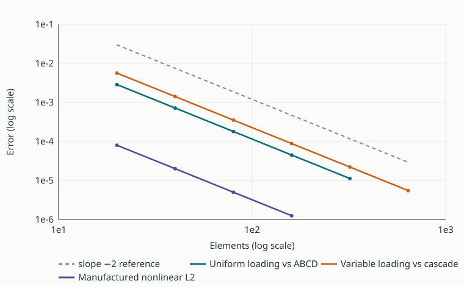
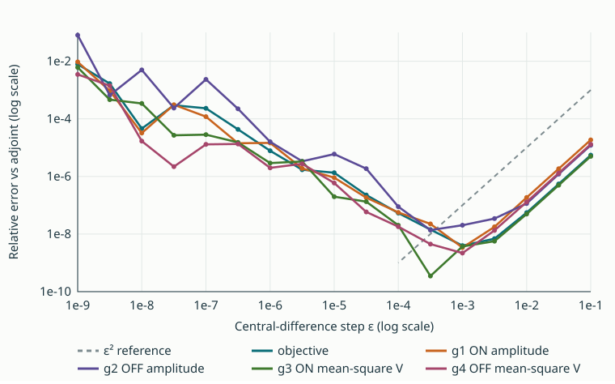
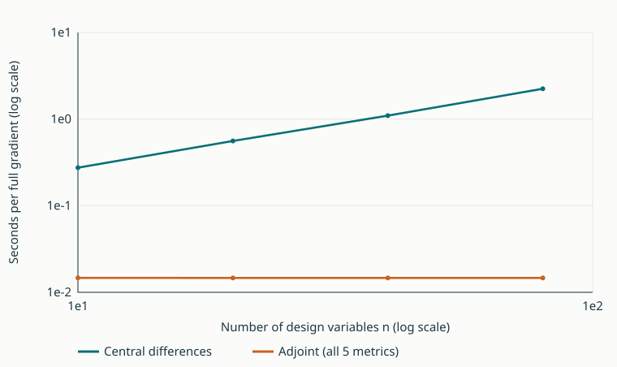
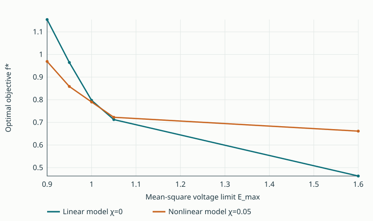
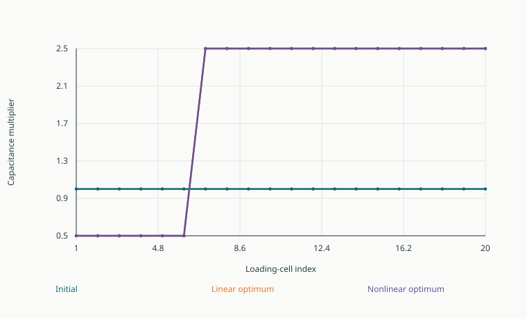
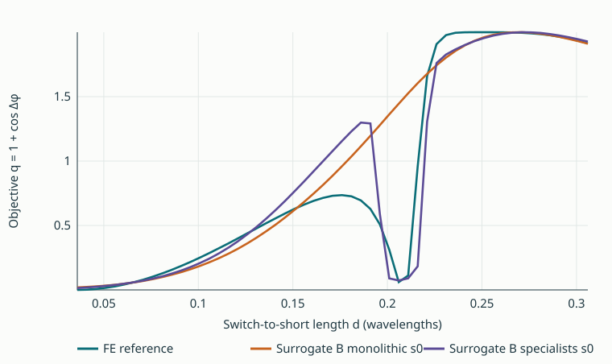
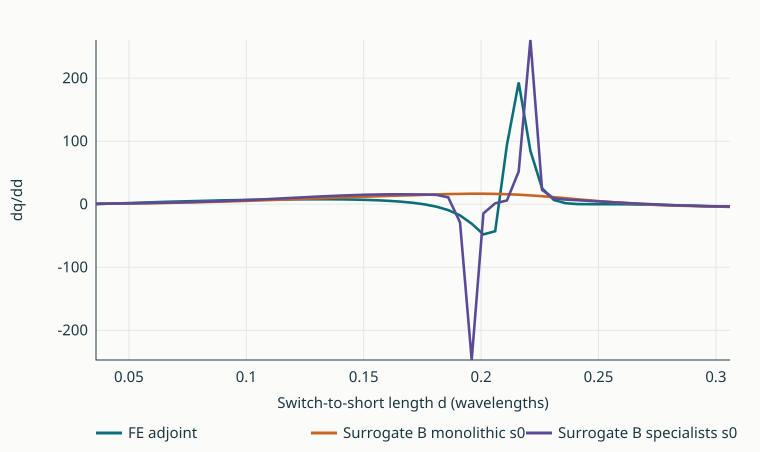

<!-- Generated by code/build_report.py from assets/*.json. Do not edit by hand. -->
## 1. Summary

**Design question.** A radio-frequency wave travels down a transmission line, passes a two-state switch and reflects from a short circuit. Can the loading along the line be chosen so that the two switch states reflect waves about 180° apart, while each state still reflects at least 80% of the incident amplitude and the line's voltage exposure stays bounded?

**Answer for this model.** The optimizer reduces the objective from **3.84135 to 0.661346** (82.8% lower), raises the ON/OFF phase separation from **7.1° to 130.5°**, and moves the design from infeasible (mean-square voltage 2.192 and 1.661 against a limit of 1.6) to **feasible on all four response constraints and all 40 loading bounds**. The optimum puts light loading on the six cells before the switch and heavy loading on the fourteen after it: every cell sits at one of its two bounds (20 of the 40 bounds active). The best design found reaches 130.5°, short of 180°. Of five starts per model, one (low-high) begins at this design, and two (linear) or three (nonlinear) of the other four reach it; none found a better local optimum within these loading bounds.

**What is new compared with Project 3.** The design reference is now a verified finite-element solver with adjoint gradients, not a neural field model. Neural surrogates of Project 3's restricted problem (new networks trained in Project 4 follow-up experiments) were also run inside a gradient-based optimizer. Their gradients and optima disagree with the finite-element reference in specific, reproducible ways (Section 10).

**Evidence labels.** **[frozen 10 Nov run]** marks results from the frozen 10 November design study, reproduced unchanged in `assets/results.json`. **[new 23 Nov run]** marks supplemental runs added on 23 November on the same unchanged solver (`assets/rubric-studies.json`, `assets/surrogate-optimizer-loop.json`). New runs never overwrite the frozen design. Studies run after the frozen optimum was known are labelled *post hoc*.

### Results: objective and every constraint **[frozen 10 Nov run]**


| Quantity | Initial ($c_j=1$), nonlinear model | Optimized, nonlinear model | Linear-model optimum, linear model |
|---|---|---|---|
| Objective $f$ (minimize) | 3.84135 | 0.661346 | 0.463035 |
| Phase separation $\Delta\phi$ (reported, not constrained) | 7.0541 | 130.534 | 139.064 |
| $g_1=\lvert R_{ON}\rvert^2-0.64\ge 0$ | 0.317177 ✓ | 0.256636 ✓ | 0.255515 ✓ |
| $g_2=\lvert R_{OFF}\rvert^2-0.64\ge 0$ | 0.33082 ✓ | 0.339557 ✓ | 0.338664 ✓ |
| $g_3=1.6-E_{ON}\ge 0$ | -0.591772 ✗ **FAIL** | 0.758223 ✓ | 0.684253 ✓ |
| $g_4=1.6-E_{OFF}\ge 0$ | -0.0614294 ✗ **FAIL** | 0.504082 ✓ | 0.395525 ✓ |
| Lower bounds: $\min_j c_j-0.5\ge 0$ | 0.5 ✓ | 0 ✓ | 0 ✓ |
| Upper bounds: $2.5-\max_j c_j\ge 0$ | 1.5 ✓ | 0 ✓ | 0 ✓ |
| $\lvert R_{ON}\rvert$ / $\lvert R_{OFF}\rvert$ | 0.9784 / 0.9853 | 0.9469 / 0.9897 | 0.9463 / 0.9893 |
| $E_{ON}$ / $E_{OFF}$ (mean-square $\lvert V\rvert^2$) | 2.192 / 1.661 | 0.8418 / 1.096 | 0.9157 / 1.204 |


All values are dimensionless (Section 3). ✓ = constraint satisfied, ✗ = violated. The smallest response-constraint slack at the optimum is 0.2566 (ON amplitude).

## 2. From Project 3 to Project 4

**The researcher's problem.** In our Project 3 interview, Nathan described electronically reconfigurable metasurfaces: copper unit cells with switches that steer or redistribute reflected RF power ([approved team briefing](https://github.com/cteraji-asu/MAE494598Optimization/blob/main/Project3-Metasurface/sources/interview/Post_Interview_Briefing.md)). We reduced one unit cell to a synthetic transmission line ([Project 3 report](https://github.com/cteraji-asu/MAE494598Optimization/blob/main/Project3-Metasurface/report.md)). A wave enters at the port, travels a length $a$ to a series switch, then a length $d$ to a short circuit. The short forces $V=0$, so a wave reflecting from it alone has reflection coefficient $\Gamma=-1$. Switching changes the switch impedance (ON: nearly a short; OFF: nearly an open). That changes the effective electrical length the wave sees, and with it the reflected phase. The design question was whether the two states can reflect about 180° apart while keeping reflected amplitude at least 0.8.

**What Project 3 found.** Project 3 trained physics-informed neural networks (PINNs) to predict the line's field as a function of the design. Average field error was low on designs similar to the training set: median voltage $L_2$ error 3.3–3.4% on the off-grid test, where all 21/21 feasible designs were retained. But in a withheld interval of switch positions near the resonant response, the same networks had 44.7–45.7% median voltage error and kept **0 of 10** feasible designs in every seed. A low average field error did not show that the model could find feasible designs, or that its design gradients could be trusted.

**What Project 4 does.**

1. Build a design-scale model the networks never saw: 20 independent loading variables and a nonlinear (voltage-dependent) loading law (Sections 3–4).
2. Solve it with our own finite-element code, verified against exact solutions (Section 5).
3. Differentiate it with adjoints, checked against finite differences (Section 6).
4. Optimize it and read the KKT multipliers (Section 7).
5. Show what the nonlinearity changes (Section 8).
6. Return to the Project 3 question with new surrogates of Project 3's restricted problem, trained with half their data in the difficult interval. Put them inside an optimizer and compare their gradients and optima with the finite-element reference (Section 10).

## 3. Structure and formulation

The line has length $L=0.36$ (in reference wavelengths $\lambda_{ref}=2\pi/\beta$). The switch sits at $a=0.108$, between cells 6 and 7, leaving $d=0.252$ to the short. All quantities are normalized: impedances by the line impedance $Z_0$, voltages by the incident amplitude, lengths by $\lambda_{ref}$.

**Design variables.** There are 20 cell loadings $c_j$, $j=1,\dots,20$. Each multiplies the nominal shunt capacitance per unit length over one cell of length $L/20=0.018$. Bounds are $0.5\le c_j\le 2.5$ (dimensionless). Line geometry is fixed. Only the distributed loading changes.

**Objective.** With $R_s$ the port reflection coefficient in state $s\in\{ON, OFF\}$:

$$
f(c)=\lvert R_{ON}+R_{OFF}\rvert^2+\frac{0.002}{20}\sum_{j=1}^{20}(c_j-1)^2,
\qquad
\lvert R_{ON}+R_{OFF}\rvert^2=\lvert R_{ON}\rvert^2+\lvert R_{OFF}\rvert^2+2\lvert R_{ON}\rvert\lvert R_{OFF}\rvert\cos\Delta\phi .
$$

The first term is smallest when the phasors oppose ($\Delta\phi=180°$) with equal magnitude. The small second term discourages unnecessary departure from nominal loading.

**Constraints** (all written $g\ge0$):

$$
g_{1,2}=\lvert R_{ON/OFF}\rvert^2-0.8^2\ge0,\qquad
g_{3,4}=1.6-E_{ON/OFF}\ge0,\qquad E_s=\frac1L\int_0^L\lvert V_s\rvert^2\,dx .
$$

| Limit | Value | Where it comes from | Status |
|---|---|---|---|
| Reflected amplitude floor | $\lvert R\rvert\ge0.8$ | Project 3 screening criterion, kept so that a non-reflecting line cannot "win" | Illustrative team choice, **not** a confirmed lab tolerance |
| Mean-square voltage | $E\le1.6$ | Synthetic exposure limit, fixed after a coarse pilot and before the final runs | Synthetic; not from a standard or data sheet. It is loose at the optimum; Section 7 tightens it post hoc |
| Loading range | $0.5\le c_j\le2.5$ | A 5:1 tuning range, comparable to commercial varactors: minimum $C(0\,\mathrm V)/C(30\,\mathrm V)=4.1$ for the Skyworks SMV1405 abrupt-junction varactor ([data sheet 200068X](https://www.skyworksinc.com/-/media/SkyWorks/Documents/Products/101-200/SMV1405_1430_Series_200068X_discontinued.pdf), Table 3) | Comparable, not derived: $c_j$ is a per-cell multiplier, not a fitted device model. Sets the bound-dominated optimum |

$E$ is a spatial average of normalized $\lvert V\rvert^2$, not stored energy and not a local voltage ceiling. These limits need instructor acceptance as part of the custom Project 3 extension (Section 13).

## 4. Analysis model

With $e^{+i\omega t}$ phasors, series impedance $z=\alpha+i\beta$ and shunt admittance $y_j=\alpha+i\beta c_j$ ($\alpha=0.03$, $\beta=2\pi$), the voltage on each side of the switch satisfies

$$
-\left(\frac{V'}{z}\right)'+y_jV+i\beta\chi\lvert V\rvert^2V=0,\qquad I=-\frac{V'}{z},
$$

with port $V(0)+I(0)=2$ (unit incident wave, matched source), short $V(L)=0$, and switch conditions $I(a^-)=I(a^+)$ and $V(a^-)-V(a^+)=Z_sI(a)$. The switch impedances are $Z_{ON}=0.02+0.04i$ and $Z_{OFF}=0.02-4i$. The reflection is $R=V(0)-1$. The nonlinear term models a voltage-dependent (cubic-charge) capacitance at the fundamental frequency, with $\chi=0.05$; $\chi=0$ is the linear comparison model.

**Weak form and elements.** Multiply by a test function $w$ with $w(L)=0$ and integrate by parts:

$$
\int_0^L\left[\frac{V'w'}{z}+y_jVw+i\beta\chi\lvert V\rvert^2Vw\right]dx+\frac{(V_{a^-}-V_{a^+})(w_{a^-}-w_{a^+})}{Z_s}+V(0)w(0)=2w(0).
$$

We use two-node linear (P1) elements, eight per cell: **160 elements and 161 complex unknowns**. The switch has two coincident nodes, so the voltage jump is represented exactly rather than smoothed. Element matrices are $K_e=\frac1h\begin{pmatrix}1&-1\\-1&1\end{pmatrix}$ and $M_e=\frac h6\begin{pmatrix}2&1\\1&2\end{pmatrix}$. The cubic term uses 4-point Gauss quadrature. Unknowns are split into real and imaginary parts, because $\lvert V\rvert^2V$ is not complex-analytic. Newton's method uses the exact real tangent and a residual line search, and stops at $\lVert F\rVert_\infty<2\times10^{-11}$.

**Assumptions.** One frequency. Fundamental-harmonic cubic loading (no generated harmonics, no transient stability). Uniform line loss $\alpha$. Lumped switch impedances. Fixed geometry. Every Newton solve starts from the linear solution, so the branch is the one connected to it (no uniqueness claim). This is a synthetic analogue of the metasurface unit cell. It is not calibrated to HFSS or to hardware.

## 5. Verification ladder

Each rung compares our number with an exact answer. Rungs marked **[new 23 Nov run]** were added in this revision. V2 is the first exact test that exercises the actual design variable (cell-by-cell loading): it compares against an independent transfer-matrix cascade written without any finite-element code.


| Rung | Kind | Test | Our number | Exact | Error (type) | Result | Evidence |
|---|---|---|---|---|---|---|---|
| V1 | Exact solution | Uniform loading vs Project 3 ABCD cascade, 320 elements | $R_{ON}$=0.183384-0.961277i | 0.183373-0.961279i | rel. 1.15e-5 | PASS | **[frozen 10 Nov run]** |
| V2 | Exact solution | Variable loading $c_j$ (random design) vs independent transfer-matrix cascade, 640 elements | -0.946347-0.203063i | -0.946348-0.203058i | rel. 5.51e-6 | PASS | **[new 23 Nov run]** |
| V3 | Convergence rate | Slope of reflection error vs elements (uniform; variable loading; optimum) | 1.999; 1.999; 2.000 | 2 (P1) | order deficit 0.0013 | PASS | **[frozen 10 Nov run]** / **[new 23 Nov run]** |
| V4 | Exact solution (nonlinear, manufactured) | Cubic $\chi\lvert V\rvert^2V$ manufactured field with switch jump, 160 elements | rel. $L_2$ error 1.52e-6; slope 2.000 | 0; slope 2 | rel. 1.52e-6 | PASS | **[frozen 10 Nov run]** |
| V5 | Global balance | Power: line loss + switch loss vs $1-\lvert R\rvert^2$ at the optimum, both states | 0.020443367 (OFF) | 0.020443367 | rel. 2.21e-11 | PASS | **[frozen 10 Nov run]** |
| V6 | Global balance (conservation) | Lossless line, reactive switches, linear and cubic: all power reflects | max $\lvert R\rvert$ deviation 1.95e-10 | $\lvert R\rvert=1$ | rel. 1.95e-10 | PASS | **[new 23 Nov run]** |
| V7 | Invariance | Rotate the incident phase by 0.73 rad: field must rotate identically (cubic law is phase-equivariant) | 6.96e-14 | 0 | abs. 6.96e-14 ($\lvert V\rvert\sim1$) | PASS | **[frozen 10 Nov run]** |
| V8 | Nonlinear benchmark | Newton: analytic tangent vs central difference (rel.); observed convergence order; with $\chi=0$ the linear initial guess must already satisfy the residual | 7.89e-10; order 1.947; 0 iterations, residual 2.84e-14 | 0; 2; 0 iterations | rel. 7.89e-10 | PASS | **[frozen 10 Nov run]** |
| V9 | Gradient check | Adjoint vs central differences ($h=10^{-3}$), all 20 coordinates, objective and all 4 constraints, 3 designs | max rel. error 2.20e-7 | 0 | rel. 2.20e-7 | PASS | **[new 23 Nov run]** |
| V10 | Gradient check (Taylor) | Central-difference error vs step: observed order before round-off, 5 metrics × 3 designs | 1.69–2.22 | 2 | order deficit 0.31 | PASS | **[new 23 Nov run]** |




**How the exact answers were obtained.** V1 uses Project 3's ABCD cascade. V2 multiplies per-cell transfer matrices $\begin{pmatrix}\cosh\gamma_j\ell&Z_j\sinh\gamma_j\ell\\ \sinh\gamma_j\ell/Z_j&\cosh\gamma_j\ell\end{pmatrix}$, with $\gamma_j=\sqrt{zy_j}$ and $Z_j=\sqrt{z/y_j}$, and a series-switch matrix $\begin{pmatrix}1&Z_s\\0&1\end{pmatrix}$. V4 chooses $V^*(x)=B(L-x)+D(L-x)^3$, adds a constant jump on the left segment, and picks $B$ so the port, short and switch conditions hold. It then generates the matching source term. V6 uses the fact that with $\alpha=0$, $\operatorname{Re}Z_s=0$ and a reactive cubic term, no power can be lost, so $\lvert R\rvert=1$ exactly. These expected values were derived by a coding agent; the team must re-derive them independently (Section 14).

## 6. Sensitivities: adjoint derivation and checks

**General form.** Stack real and imaginary nodal voltages in $u$ and write the assembled residual as $F(u,c)=0$, with tangent $J=\partial F/\partial u$ at the converged Newton state. For any response $q(u,c)$,

$$
J^{\mathsf T}\lambda=\left(\frac{\partial q}{\partial u}\right)^{\mathsf T},\qquad
\frac{dq}{dc_j}=\frac{\partial q}{\partial c_j}-\lambda^{\mathsf T}\frac{\partial F}{\partial c_j}.
$$

This differentiates the converged state equation (implicit differentiation), not the Newton iterations. Each switch state has its own state equation, so each state gets one transposed solve with $J^{\mathsf T}$, shared by all metrics.

**Design derivative of the residual.** Only the shunt term depends on $c_j$: $\partial F_i/\partial c_j=i\beta\int_{\text{cell }j}N_iV\,dx$, split into real and imaginary rows. It is proportional to the local voltage. That is why the loading next to the short, where $V\to0$, has almost no influence (Section 7).

**Kind 1: port functionals** (objective and $g_1$, $g_2$). $R_s=u_0+iu_n-1$. For $q=\lvert R_s\rvert^2$, $\partial q/\partial u$ is $2\operatorname{Re}R_s$ at the real port entry and $2\operatorname{Im}R_s$ at the imaginary port entry. For the objective, with $S=R_{ON}+R_{OFF}$, the entries are $2\operatorname{Re}S$ and $2\operatorname{Im}S$ in each state's adjoint.

**Kind 2: domain functionals** ($g_3$, $g_4$). $E_s=\frac1L(a^{\mathsf T}Ma+b^{\mathsf T}Mb)$, with $a$ and $b$ the real and imaginary nodal voltages and $M$ the global consistent mass matrix. So $\partial E_s/\partial u=\frac2L(Ma;\,Mb)$, with a minus sign for $g=1.6-E$.

**The nonlinear term in the tangent.** Write $V=a+ib$ at a quadrature point. The cubic loading $i\beta\chi\lvert V\rvert^2V$ is not complex-differentiable, so its derivative is taken with respect to $a$ and $b$ separately:

$$
\frac{\partial(\lvert V\rvert^2V)}{\partial a}=(3a^2+b^2)+2iab,\qquad
\frac{\partial(\lvert V\rvert^2V)}{\partial b}=2ab+i(a^2+3b^2).
$$

Multiplied by $i\beta\chi$ and integrated against $N_iN_k$, these give the real 2×2 blocks added to the linear operator in $J$. The same $J$, transposed, is the adjoint operator. The cubic term does not contain $c_j$, so it adds nothing to $\partial F/\partial c_j$. It enters the gradient only through $J^{\mathsf T}$ and the converged state. V8 checks this tangent against a central difference of the residual.

**Kind 3: explicit terms.** $\partial f/\partial c_j$ gains $\frac{2\cdot0.002}{20}(c_j-1)$. Bound constraints are explicit and need no adjoint.

**Variable types.** The design has one kind of variable: cell loading multipliers. The check below covers every coordinate of that kind, for the objective and every constraint.

**Gradient check, every coordinate** **[new 23 Nov run]**. Central differences perturb each of the 20 loadings. The table gives the relative vector error $\lVert\nabla_{adj}-\nabla_{FD}\rVert/\lVert\nabla_{FD}\rVert$ at $h=10^{-3}$, near the best step found by the Taylor test below, and in brackets at $h=10^{-5}$. The larger errors at $h=10^{-5}$ (up to 2.40e-5) are finite-difference round-off, not adjoint error:


| Metric | Initial $c_j=1$, $h=10^{-3}$ ($h=10^{-5}$) | Random interior design, $h=10^{-3}$ ($h=10^{-5}$) | Selected optimum, $h=10^{-3}$ ($h=10^{-5}$) |
|---|---|---|---|
| Objective $f$ | 8.45e-8 (3.57e-6) | 4.58e-9 (1.36e-7) | 1.13e-8 (1.04e-7) |
| $g_1$ ON amplitude | 1.44e-7 (6.23e-6) | 3.61e-9 (2.36e-7) | 1.50e-8 (2.00e-6) |
| $g_2$ OFF amplitude | 5.15e-8 (4.81e-6) | 1.52e-7 (1.32e-5) | 2.20e-7 (2.40e-5) |
| $g_3$ ON mean-square V | 9.21e-9 (1.98e-7) | 3.27e-9 (1.29e-7) | 2.64e-9 (1.04e-7) |
| $g_4$ OFF mean-square V | 1.68e-8 (8.90e-8) | 5.61e-9 (1.01e-7) | 1.09e-8 (1.82e-7) |


**Taylor test** **[new 23 Nov run]**. Along a random unit direction, the central-difference error falls as $\varepsilon^2$ (observed order over the first decade ≥ 1.69). It reaches its minimum at $\varepsilon\approx3.16e-5$–$0.003$ and then rises again as round-off in the Newton solves grows like $1/\varepsilon$. That V shape is the expected signature of a correct gradient; a flat curve would indicate a wrong adjoint. The figure shows the random interior design. The initial and optimized designs behave the same way (orders 1.69–2.01 and 2.00–2.22; curves in `assets/rubric-studies.json`). V10 passes if every first-decade order exceeds 1.6.



The frozen study's first-order Taylor remainder ($q(c+hv)-q(c)-h\nabla q\cdot v$ falls as $h^2$) is retained as a second check **[frozen 10 Nov run]**:


**Cost: adjoint versus finite differences** **[new 23 Nov run]**. One adjoint gradient of all five metrics costs 2 Newton solves plus 2 transposed linear solves with 5 right-hand sides each. Central differences cost $4n$ Newton solves. To show the scaling, the same line was re-meshed with 10–80 loading cells at a fixed 160 elements:


| Design variables $n$ | Elements | FD Newton solves | Adjoint solves | FD time (s, median of 7) | Adjoint time (s) | FD / adjoint |
|---|---|---|---|---|---|---|
| 10 | 160 | 40 | 2 + 2 transposed | 0.275 | 0.0147 | 19× |
| 20 | 160 | 80 | 2 + 2 transposed | 0.559 | 0.0146 | 38× |
| 40 | 160 | 160 | 2 + 2 transposed | 1.1 | 0.0146 | 75× |
| 80 | 160 | 320 | 2 + 2 transposed | 2.24 | 0.0147 | 153× |




At the project's 20 variables, the adjoint is about 38× faster; at 80 variables, about 153×. The finite-difference time grows linearly with $n$, while the adjoint time stays nearly constant. The frozen study's single timing (0.536 s versus 0.0139 s) agrees. Times are from one laptop CPU and vary between machines.

## 7. Optimization

**Setup** **[frozen 10 Nov run]**. SciPy SLSQP, analytic adjoint gradients, bounds $[0.5,2.5]$, `ftol` $10^{-11}$, at most 500 iterations. Variables are already $O(1)$ and centered on 1. The frozen run left the constraints in their natural units ($\lvert R\rvert^2$ and normalized $\lvert V\rvert^2$, both $O(0.1$–$1)$). To check that this choice does not matter, the problem was re-solved **[new 23 Nov run]** with constraints scaled as $g/g_{limit}-1$ ($\lvert R\rvert^2/0.64-1\ge0$, $1-E/1.6\ge0$). 4 of 5 starts (3 of 4 independent ones, excluding the low-high vertex start) converge to the same design (max difference 9.60e-13). The high-low start fails exactly as before. Both models used the same five starts: uniform, low-before/high-after, high-before/low-after and two seeded random designs. Every outcome is kept, including the two failures.


| Model | Start | Iterations | Final objective | KKT stationarity | Converged & feasible | Optimizer message |
|---|---|---|---|---|---|---|
| Linear ($\chi=0$) | uniform | 91 | 3.86276 | 1.39e-8 | yes | Optimization terminated successfully |
| Linear ($\chi=0$) | low high | 1 | 0.463035 | 1.39e-17 | yes | Optimization terminated successfully |
| Linear ($\chi=0$) | high low | 22 | 2.86866 | 7.55e-15 | **no** | Positive directional derivative for linesearch |
| Linear ($\chi=0$) | random 494 a | 22 | 0.463035 | 1.39e-17 | yes | Optimization terminated successfully |
| Linear ($\chi=0$) | random 494 b | 18 | 0.463035 | 1.39e-17 | yes | Optimization terminated successfully |
| Nonlinear ($\chi=0.05$) | uniform | 27 | 0.661346 | 1.39e-17 | yes | Optimization terminated successfully |
| Nonlinear ($\chi=0.05$) | low high | 1 | 0.661346 | 2.78e-17 | yes | Optimization terminated successfully |
| Nonlinear ($\chi=0.05$) | high low | n/a | n/a | n/a | **no** | Newton line search failed |
| Nonlinear ($\chi=0.05$) | random 494 a | 22 | 0.661346 | 2.78e-17 | yes | Optimization terminated successfully |
| Nonlinear ($\chi=0.05$) | random 494 b | 18 | 0.661346 | 2.78e-17 | yes | Optimization terminated successfully |


The low-high start is the optimal bound pattern itself, so it converges in one iteration and is not independent evidence. The linear model's uniform start "converged" to a poor stationary point: SLSQP reports success, but $f$ ends at 3.86276, slightly worse than its start (3.83625 in the linear model). Its high-low start stopped with a line-search failure. The nonlinear high-low start failed inside Newton's method at its first design. A diagnosis **[new 23 Nov run]** shows why. That design (heavy loading before the switch) puts a strong standing wave in the OFF state: $\max\lvert V\rvert=2.88$ even in the linear model, where the cubic term would be 83% of the linear loading. Gradual continuation in $\chi$ from the linear state also fails, at $\chi=0.01$. The same start converges in the $\chi$ sweep at $\chi=0.1$ (to a poor $f=3.864$) and $\chi=0.3$, and fails again at $\chi=0.2$. So whether Newton finds a solution from the linear initial guess depends on $\chi$ in a non-monotone way. That is consistent with multiple nonlinear solution branches and a narrow basin around the linear state, not a solver defect (the ON state converges, and the tangent is verified by V8). We have not mapped the branches, so the mechanism is not proven. Excluding the low-high start, two of four (linear) and three of four (nonlinear) independent starts reach the best design.


**Active constraints and multipliers.** With $\mathcal L=f-\sum_i\mu_ig_i$, $g_i\ge0$, $\mu_i\ge0$, one bound per cell is active (20 of 40): cells 1–6 at the lower bound and cells 7–20 at the upper bound. The four response constraints have slack, so their multipliers are zero. KKT stationarity holds to $10^{-17}$. A multiplier $\mu_j$ is the objective improvement per unit widening of that cell's loading range. To test this, each bound was widened by $\delta=0.02$ and the problem re-solved **[new 23 Nov run]**:


| Cell | Side | Active bound | μ linear | μ nonlinear | Predicted Δf (δ=0.02) | Re-solved Δf | Difference |
|---|---|---|---|---|---|---|---|
| 1 | before switch | lower 0.5 | 0.1878 | 0.1434 | -0.00287 | -0.00287 | 0.0% |
| 2 | before switch | lower 0.5 | 0.2263 | 0.1968 | -0.00394 | -0.00394 | 0.0% |
| 3 | before switch | lower 0.5 | 0.2569 | 0.2418 | -0.00484 | -0.00483 | 0.1% |
| 4 | before switch | lower 0.5 | 0.2788 | 0.2765 | -0.00553 | -0.00553 | 0.1% |
| 5 | before switch | lower 0.5 | 0.2915 | 0.2992 | -0.00598 | -0.00598 | 0.1% |
| 6 | before switch | lower 0.5 | 0.2946 | 0.3084 | -0.00617 | -0.00616 | 0.1% |
| 7 | after switch | upper 2.5 | 0.06201 | 0.05126 | -0.00103 | -0.00102 | 0.1% |
| 8 | after switch | upper 2.5 | 0.08707 | 0.07722 | -0.00154 | -0.00154 | 0.1% |
| 9 | after switch | upper 2.5 | 0.11 | 0.1024 | -0.00205 | -0.00204 | 0.2% |
| 10 | after switch | upper 2.5 | 0.128 | 0.1233 | -0.00247 | -0.00246 | 0.2% |
| 11 | after switch | upper 2.5 | 0.1387 | 0.1371 | -0.00274 | -0.00274 | 0.2% |
| 12 | after switch | upper 2.5 | 0.1407 | 0.1418 | -0.00284 | -0.00283 | 0.2% |
| 13 | after switch | upper 2.5 | 0.1339 | 0.1368 | -0.00274 | -0.00273 | 0.1% |
| 14 | after switch | upper 2.5 | 0.119 | 0.1228 | -0.00246 | -0.00245 | 0.1% |
| 15 | after switch | upper 2.5 | 0.09793 | 0.1017 | -0.00203 | -0.00203 | 0.1% |
| 16 | after switch | upper 2.5 | 0.07342 | 0.07659 | -0.00153 | -0.00153 | 0.0% |
| 17 | after switch | upper 2.5 | 0.04856 | 0.05077 | -0.00102 | -0.00102 | 0.0% |
| 18 | after switch | upper 2.5 | 0.02648 | 0.02773 | -5.55e-4 | -5.55e-4 | 0.0% |
| 19 | after switch | upper 2.5 | 0.01 | 0.01048 | -2.10e-4 | -2.10e-4 | 0.0% |
| 20 | after switch | upper 2.5 | 0.001205 | 0.001275 | -2.55e-5 | -2.55e-5 | 0.1% |


**Engineering reading.**

- The most valuable extra range is just before the switch: cell 6, $\mu=0.308$. Lighter loading there would lower the objective the most.
- On the short side, the largest upper-bound multipliers are cells 11, 12, 13, in the middle of the switch-to-short segment.
- Cell 20, next to the short, is worth almost nothing ($\mu=0.0013$). The voltage vanishes at the short, so loading there barely changes the wave.
- Widening every range by 0.02 is predicted to lower $f$ by 0.05255; the re-solve lowers it by 0.05166. The small difference is the second-order term.

In engineering terms, the design is limited by how far the tunable capacitance can go, not by the voltage or amplitude limits.

**What if the voltage limit mattered?** *Post hoc* **[new 23 Nov run]**. At $E_{max}=1.6$ the voltage limit is loose, so the frozen problem says nothing about its price. We re-solved with tighter limits, using the five frozen starts plus a warm start, and checked each voltage multiplier against a finite difference of re-solved optima:


| Limit $E_{max}$ | $\chi$ | Optimal $f$ | Δφ (°) | Active response constraints | μ | $\Delta f^*/\Delta E_{max}$ re-solve vs −Σμ |
|---|---|---|---|---|---|---|
| 1.6 | 0.0 | 0.46303 | 139.06 | none (bounds only) | 0 |  |
| 1.05 | 0.0 | 0.7124 | 128.44 | $E_{OFF}$ | 1.681 | -1.679 vs -1.681 |
| 1.0 | 0.0 | 0.79737 | 125.17 | $E_{OFF}$ | 1.717 | -1.715 vs -1.717 |
| 0.95 | 0.0 | 0.96477 | 119.17 | $E_{ON}$, $E_{OFF}$ | 1.478, 2.279 | -3.753 vs -3.757 (re-solve flagged not converged) |
| 0.9 | 0.0 | 1.1543 | 112.81 | $E_{ON}$, $E_{OFF}$ | 1.558, 2.267 | -3.822 vs -3.825 |
| 1.6 | 0.05 | 0.66135 | 130.53 | none (bounds only) | 0 |  |
| 1.05 | 0.05 | 0.72242 | 128.10 | $E_{OFF}$ | 1.341 | -1.34 vs -1.341 |
| 1.0 | 0.05 | 0.79001 | 125.50 | $E_{OFF}$ | 1.362 | -1.361 vs -1.362 |
| 0.95 | 0.05 | 0.85853 | 122.94 | $E_{OFF}$ | 1.378 | -1.377 vs -1.378 |
| 0.9 | 0.05 | 0.96913 | 118.99 | $E_{ON}$, $E_{OFF}$ | 1.884, 2.259 | -4.138 vs -4.143 (re-solve flagged not converged) |




Once the OFF-state voltage limit binds, its multiplier (about 1.34 in the nonlinear model at $E_{max}=1.05$) prices the trade-off. Each 0.01 tightening of the OFF-state mean-square voltage costs about 0.013 in $f$ and roughly 0.5–0.8° of phase separation. These tighter limits are sensitivity studies; the frozen formulation and its optimum are unchanged.

## 8. Nonlinear component (N2)

**What is nonlinear.** The state equation itself is nonlinear: the cubic voltage-dependent loading $i\beta\chi\lvert V\rvert^2V$. It is solved by Newton's method and differentiated implicitly at the converged state (Sections 4 and 6). It is checked against a manufactured nonlinear solution (V4), quadratic Newton convergence (V8) and phase equivariance (V7). The nonlinearity is not small where the voltage is large. At the optimum, $\chi\lvert V\rvert^2/c$ reaches 0.45 in the OFF state (mean 0.10) and 0.051 in the ON state. Locally, the voltage-dependent part adds up to about 45% of the linear loading.

**With and without, frozen problem** **[frozen 10 Nov run]**. Optimizing with $\chi=0$ and with $\chi=0.05$ gives the same design: max $\lvert\Delta c\rvert=9.60e-13$ between the two frozen selected designs. The $\chi$-sweep table below re-solves both models, so its differences, measured against the re-solved linear design, are of the same round-off size but not identical. The response does change: the linear model predicts $\Delta\phi=139.06°$ and $f=0.463035$, while the nonlinear model gives $130.53°$ and $f=0.661346$ at the same loading. The nonlinearity detunes the line and costs 8.5° of phase separation, but it does not move the optimum.

**Why the design does not move.** The optimum is a vertex of the bound box. It stays optimal as long as every bound multiplier stays positive, i.e. as long as every cell still "wants" to move further in the same direction. The nonlinearity changes the multipliers but flips no sign. The smallest is 0.0012 (linear) versus 0.00128 (nonlinear), and the cell-1 lower-bound multiplier drops from 0.188 to 0.143. Raising $\chi$ shows when that stops being true *post hoc* **[new 23 Nov run]**:


| $\chi$ | Best $f$ | Δφ (°) | max Δc from linear design | μ of cell 1 lower bound | max $\chi\lvert V\rvert^2/c$ (OFF) | Starts that failed |
|---|---|---|---|---|---|---|
| 0.0 | 0.46303 | 139.06 | 0 | 0.1878 | 0.000 | high low |
| 0.05 | 0.66135 | 130.53 | 3.42e-14 | 0.1434 | 0.449 | high low |
| 0.1 | 0.82593 | 124.23 | 7.99e-14 | 0.09749 | 0.841 | none |
| 0.2 | 1.062 | 115.94 | 3.33e-14 | 0.02582 | 1.496 | high low |
| 0.3 | 1.1477 | 112.85 | 2 | cell 1 at upper bound | 1.740 | none |


As $\chi$ grows, cell 1's multiplier shrinks. At $\chi=0.3$, cell 1 (at the port) switches from the lower to the upper bound and the design changes. The frozen $\chi=0.05$ sits well inside the range where the bound pattern is unchanged.

**With and without, when the voltage limit binds** *post hoc* **[new 23 Nov run]**. Here the nonlinearity does change the design. We optimized with each model and evaluated the linear model's design in the nonlinear model:


| $E_{max}$ | max Δc (linear vs nonlinear design) | Nonlinear optimum $f$ | Linear design in nonlinear model $f$ | Penalty for ignoring nonlinearity | Δφ (°) nonlinear / linear design | Linear design feasible? |
|---|---|---|---|---|---|---|
| 1.6 | 0 | 0.66135 | 0.66135 | 0.0% | 130.53 / 130.53 | yes |
| 1.05 | 0.875 | 0.72242 | 0.8435 | 16.8% | 128.10 / 123.49 | yes |
| 1.0 | 0.839 | 0.79001 | 0.90282 | 14.3% | 125.50 / 121.31 | yes |
| 0.95 | 0.547 | 0.85853 | 1.0625 | 23.8% | 122.94 / 115.80 | yes |
| 0.9 | 0.985 | 0.96913 | 1.2479 | 28.8% | 118.99 / 109.74 | yes |




With the voltage limit active, the linear model overpredicts the OFF-state voltage. Its design is therefore over-conservative, and it pays 14–29% in objective relative to the design that accounts for the nonlinearity. The designs differ only in cell 1, at the port, and, at the two tightest limits, cell 6, next to the switch. These are the cells that trade phase contrast against OFF-state voltage.

**Conclusion.** For the frozen problem, ignoring the nonlinearity would give the right design but a wrong prediction of its performance (8.5° too optimistic). For a problem with an active voltage limit, ignoring it gives a worse design.

## 9. Website and 3D comparison

The viewer at the top of this page loads `assets/results.json`. It shows the initial and optimized designs side by side with linked cameras, and the solved voltage magnitude drawn on the line with the elements' own linear shape functions. The port, switch and short are labeled. Three things are graphical encodings, not dimensions, and the viewer labels them: block heights show the loading $c_j$, ribbon height shows $\lvert V\rvert$, and the line is a 1D model extruded for display. The animation replays the recorded SLSQP iterates of the selected run, with the ON/OFF reflection phasors drawn for each iterate. Constraint failures are marked with "✗ FAIL" text and a hatched badge, not by color alone.

## 10. Neural surrogates of the Project 3 problem against the finite-element reference

**What the surrogates are.** These are **not** the original Project 3 networks. Two frozen Project 4 follow-up experiments trained new PINNs, three seeds per arm. Each run had the same physics loss as Project 3, but half of the 256 training designs were inside Project 3's difficult interval $0.195\le d\le0.222$. Each experiment compared one monolithic network with two specialist networks of matched size and budget, one for that interval and one for the rest. Experiment A routed hard between them, which creates reflection jumps of about 1 at the interval edges ([two-pinn-findings.md](two-pinn-findings.md)). Experiment B blended them smoothly. All model only Project 3's restricted family: one design variable $d$ (switch-to-short length), uniform loading, linear physics. They are **not** a surrogate for the 20-variable nonlinear problem above.

**Experiment A — hard routing between two networks** **[frozen 10 Nov run]**

| Model | Seed | Reflection error p95 | Median field $L_2$ error (%) | Feasible retained | False feasible | Design-gradient error (%) | Gate |
|---|---|---|---|---|---|---|---|
| monolithic | 0 | 1.49 | 5.48 | 0/24 | 0 | 95.5 | **FAIL** |
| two specialists | 0 | 1.09 | 4.17 | 2/24 | 0 | 85.6 | **FAIL** |
| monolithic | 1 | 1.48 | 4.61 | 7/24 | 0 | 95.6 | **FAIL** |
| two specialists | 1 | 1.14 | 3.87 | 10/24 | 0 | 89 | **FAIL** |
| monolithic | 2 | 1.41 | 4.53 | 0/24 | 0 | 95.1 | **FAIL** |
| two specialists | 2 | 1.17 | 4.46 | 0/24 | 0 | 90.7 | **FAIL** |

**Experiment B — differentiable (smooth) blending** **[frozen 10 Nov run]**

| Model | Seed | Reflection error p95 | Median field $L_2$ error (%) | Feasible retained | False feasible | Design-gradient error (%) | Gate |
|---|---|---|---|---|---|---|---|
| monolithic | 0 | 1.47 | 5.06 | 12/23 | 0 | 95 | **FAIL** |
| smooth specialists | 0 | 1.09 | 3.93 | 12/23 | 0 | 109 | **FAIL** |
| monolithic | 1 | 1.47 | 3.9 | 13/23 | 0 | 94.9 | **FAIL** |
| smooth specialists | 1 | 1.13 | 4.15 | 13/23 | 0 | 108 | **FAIL** |
| monolithic | 2 | 1.44 | 4.49 | 16/23 | 3 | 95 | **FAIL** |
| smooth specialists | 2 | 1.15 | 4.79 | 12/23 | 0 | 106 | **FAIL** |


Every network fails the unchanged acceptance gate. Their design-gradient errors (86–109%) were already a warning.

**Surrogate inside an optimizer** **[new 23 Nov run]**. Both arms run SLSQP on the restricted problem with the same starts, bounds and constraints:

- Minimize $q(d)=1+\cos\Delta\phi$ (zero at 180°).
- Subject to $\lvert R_{ON}\rvert^2-0.64\ge0$ and $\lvert R_{OFF}\rvert^2-0.64\ge0$.
- Bounds $0.036\le d\le0.306$.

The surrogate arm takes values and design gradients from each saved network by automatic differentiation. The reference arm uses our own two-segment P1 finite-element model (128 elements per segment, mesh-converged, shape adjoint checked by finite differences in `review/restricted-fe-bridge-2026-11-16.json`). No network was retrained or re-selected. 60 surrogate optimizations ran in 15 s. The 3 Experiment A specialist models are discontinuous at the interval edges, so a gradient optimizer is not well posed on them. Their runs are reported for completeness. The conclusions below hold for the 9 continuous models alone.

The finite-element reference is itself multimodal:


| Start $d_0$ | FE-adjoint SLSQP endpoint $d$ | FE objective $q$ | Exact Δφ (°) | Endpoint |
|---|---|---|---|---|
| 0.06 | 0.03600 | 4.31e-5 | 179.47 | bound |
| 0.12 | 0.03600 | 4.31e-5 | 179.47 | bound |
| 0.18 | 0.20843 | 2.24e-13 | 179.99 | interior |
| 0.24 | 0.03600 | 4.31e-5 | 179.47 | bound |
| 0.30 | 0.30600 | 1.91 | 23.94 | bound |


The FE adjoint finds the interior resonant optimum $d=0.20843$ ($\Delta\phi=179.99°$) only from $d_0=0.18$. From other starts it reaches the lower bound $d=0.036$ ($\Delta\phi\approx179.5°$, a nearly-as-good boundary design) or a poor upper-bound point.


| Surrogate | Seed | Gradient rel. $L_2$ error vs FE adjoint | Wrong gradient sign | Endpoint from $d_0=0.18$ | Endpoint from $d_0=0.24$ | Own optimum: predicted $q$ vs FE $q$ |
|---|---|---|---|---|---|---|
| A monolithic | 0 | 0.966 | 18% | 0.0360 (FE $q$ 4.31e-5) | 0.2395 (FE $q$ 2) | 0.0419 vs 4.31e-5 |
| A two specialists | 0 | 0.866 | 20% | 0.0360 (FE $q$ 4.31e-5) | 0.0360 (FE $q$ 4.31e-5) | 0.0353 vs 4.31e-5 |
| A monolithic | 1 | 0.966 | 20% | 0.0360 (FE $q$ 4.31e-5) | 0.2439 (FE $q$ 2) | 0.0297 vs 4.31e-5 |
| A two specialists | 1 | 0.899 | 20% | 0.0360 (FE $q$ 4.31e-5) | 0.0360 (FE $q$ 4.31e-5) | 0.0186 vs 4.31e-5 |
| A monolithic | 2 | 0.962 | 20% | 0.0409 (FE $q$ 0.0022) | 0.2537 (FE $q$ 2) | 0.0364 vs 0.0022 |
| A two specialists | 2 | 0.917 | 18% | 0.0360 (FE $q$ 4.31e-5) | 0.0360 (FE $q$ 4.31e-5) | 0.0412 vs 4.31e-5 |
| B monolithic | 0 | 0.962 | 18% | 0.0360 (FE $q$ 4.31e-5) | 0.2472 (FE $q$ 2) | 0.0194 vs 4.31e-5 |
| B smooth specialists | 0 | 1.35 | 15% | 0.0360 (FE $q$ 4.31e-5) | 0.0360 (FE $q$ 4.31e-5) | 0.0143 vs 4.31e-5 |
| B monolithic | 1 | 0.959 | 20% | 0.0360 (FE $q$ 4.31e-5) | 0.2456 (FE $q$ 2) | 0.0147 vs 4.31e-5 |
| B smooth specialists | 1 | 1.47 | 15% | 0.0360 (FE $q$ 4.31e-5) | 0.0360 (FE $q$ 4.31e-5) | 0.0117 vs 4.31e-5 |
| B monolithic | 2 | 0.963 | 18% | 0.0360 (FE $q$ 4.31e-5) | 0.2531 (FE $q$ 2) | 0.00847 vs 4.31e-5 |
| B smooth specialists | 2 | 1.47 | 15% | 0.0360 (FE $q$ 4.31e-5) | 0.0360 (FE $q$ 4.31e-5) | 0.0148 vs 4.31e-5 |






**Where they disagree, and why.**

1. **Gradients.** Across the design range, the surrogate gradients differ from the FE adjoint by 0.87–1.47 in relative $L_2$ norm and have the wrong sign at 15–20% of 55 sampled designs. The networks were trained to match field values, not their derivatives with respect to the design. Small field errors that vary with $d$ produce large slope errors, and that is exactly what the optimizer follows.
2. **Missed optimum.** None of the 12 surrogates reaches the interior resonant optimum (0 of 60 runs end within 0.005 of it). From $d_0=0.18$, where the FE adjoint climbs to $d=0.2084$, every surrogate heads the other way, toward the lower bound (endpoints $d\le0.041$). The reason is visible in a dense check inside the difficult interval, even though half the training designs lay there. There the true objective dips to 6.90e-5 at $d=0.2085$. The monolithic surrogates never predict a dip: their lowest value in the interval is 1.25–1.31, their mean objective error is 0.93–0.97 (on a 0–2 scale), and their gradient error is 0.95. The smooth-blend specialists do predict a shallow dip, but at $d=0.2038–0.2047$ with minimum 0.07, mean error 0.29–0.31 and gradient error 1.14–1.15. Outside the interval, mean objective errors are only 0.08–0.14 below it and 0.03–0.05 above it. The surrogates smooth away the resonance, so an optimizer following them cannot reach it.
3. **Spurious stationary points.** From $d_0=0.24$, 6 of 12 surrogates stop near $d\approx0.24$–$0.25$, where their gradient vanishes. The FE objective there is about 2, its worst possible value ($\Delta\phi\approx0°$). The FE adjoint from the same start does not stop there.
4. **Wrong self-assessment.** At their chosen designs ($d=0.036$–$0.041$, at or next to the lower box bound), the surrogates predict $q=0.0085$–$0.042$ (phase error 7.5–16.6°). FE gives $q=4.31e-5$–$0.0022$ (phase error 0.53–3.8°). The chosen designs happen to be good. That is luck of the bound placement, not evidence that the surrogate understood the response. Its predicted objective was 17–972 times the FE value.

**Why the negative result matters.** A surrogate that is accurate on average can still send a gradient-based optimizer the wrong way: wrong-sign components, false stationary points, blindness where the response is resonant. In 20 dimensions there would be no exhaustive check to catch this. The FE solver with adjoint gradients remains the design reference. Any surrogate must be validated on gradients and on optimizer endpoints, not on field error alone.

**Correction to the 16 November draft.** That draft said the surrogates' grid search "selects a different design" ($d=0.036$ versus 0.2084) without stating that FE rates $d=0.036$ as feasible with $\Delta\phi\approx179.5°$. The FE re-evaluation above corrects that framing: the decisive disagreements are gradients, missed and spurious stationary points, and self-assessment, not the endpoint alone.

**Bonus status.** These are trained surrogates used inside a gradient-based optimizer, with gradients and optima compared and the disagreements explained. They are applied only to the restricted one-variable linear family, not to this project's 20-variable optimizer. We do not count this toward the score; whether it qualifies for the surrogate bonus is the instructor's decision. The N2 solver and nonlinear benchmark are relevant to the "fully nonlinear" bonus; that, too, is not assumed.

## 11. Reproducibility

One command regenerates every result, figure and page in a fresh directory, without overwriting the retained evidence:

```sh
python Project4-Metasurface/reproduce.py
```

It reruns:

- the frozen verification and multistart design study (`code/run_design.py`, about 3.9 s);
- both neural experiments and their audits;
- the supplemental gradient sweep, the surrogate–FE comparisons, `code/rubric_studies.py` (about 70 s) and `code/surrogate_optimizer_loop.py`;
- all tests;
- the report and site generator (`code/build_report.py`).

This page, `report.md`, the viewer's numbers and every figure are generated from the JSON files listed in Section 1, plus `assets/two-pinn-results.json` and `assets/smooth-pinn-results.json` for the Section 10 network tables. The only exceptions are the Project 3 figures in Section 2, quoted from the Project 3 report, and the declared constants of the formulation. Pinned versions are in `requirements.txt`. Timings differ between machines.

## 12. Limitations

- Synthetic reduced model: one frequency, a 1D line standing in for a 3D periodic copper unit cell, lumped switch impedances. No HFSS or hardware calibration.
- The cubic loading is a fundamental-harmonic model: no generated harmonics, no transient stability, no claim of a unique nonlinear branch.
- The optimum is local (multistart, not global), bound-dominated, and reaches 130.5°, not 180°. The 0.8 amplitude floor and the 1.6 voltage limit are illustrative, not confirmed requirements.
- One kind of design variable (cell loading). No shape variable in the 20-variable problem; shape gradients appear only in the restricted switch-position family (Section 10).
- The 3D view is an extruded 1D model. Block and ribbon heights are data encodings, not fabricated dimensions.
- The post hoc studies (voltage-limit and $\chi$ sweeps) were designed after seeing the frozen optimum. They explain it; they do not replace it.

## 13. Custom-project requirements

| Requirement for a proposed structure | This project | Status |
|---|---|---|
| Objective and at least two constraints are functionals of a PDE solution our code computes | Objective and all four constraints come from the FE state | Met |
| At least 20 design variables | 20 cell loadings | Met (exactly 20) |
| A nonlinear component (N1 or N2) | N2: cubic loading, Newton, implicit adjoint | Met |
| Can be shown in 3D (2D may be extruded) | A **1D** line extruded for display | **Needs instructor confirmation** that an extruded 1D line is acceptable |
| A reduced version optimizes on a laptop in minutes | Full study about 3.9 s | Met |
| Custom structure approved by the instructor (due 4 Nov) | No approval record in the repository | **Needs instructor confirmation** |
| Limits cited from a standard or data sheet where applicable | Limits are synthetic and labelled as such | **Needs instructor acceptance** of synthetic limits |
| Own FE solver and adjoint gradients (Project 3 extension rule) | Own P1 solver and adjoints in `code/wave_fem.py` | Met |

## 14. AI-use statement

**What the coding agents wrote.** Coding agents wrote essentially all code and text in this folder:

- the formulation, FE/Newton solver, adjoints and optimization harness;
- the verification tests and the neural experiments;
- the figures, this report and the 3D viewer.

That covers the 10–16 November sessions and, on 23 November, a Hermes Agent session (Claude), which added `rubric_studies.py`, `surrogate_optimizer_loop.py`, this report structure and the redesigned viewer. Separate agent reviews checked results.

**Bugs the verification caught.** These are the recorded defects, stated as they happened:

1. A run exposed a harness defect: a failed Newton solve at one start aborted saving the results. The harness now records that start as a failure.
2. Browser QA found the viewer computing upper-bound slack as $2.5$ instead of $2.5-c_j$. A regression test now covers it.
3. In this revision, re-evaluating the surrogates' chosen design with FE caught an overstated claim in the 16 November draft (Section 10).
4. Two independent agent review passes of this revision found draft errors, which were fixed before this version: the surrogates had been called "the Project 3 networks" with a causal claim borrowed from Project 3's error figures; the Taylor-test text placed the round-off floor at the wrong step; a broken viewer test; and a start counted as independent although it began at the optimum. These are review catches, not ladder catches.

No ladder rung has recorded catching a solver bug; we do not invent one.
